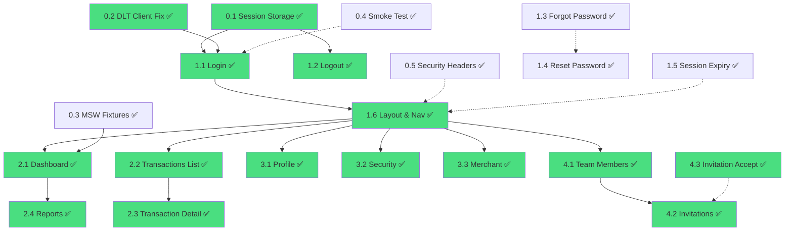
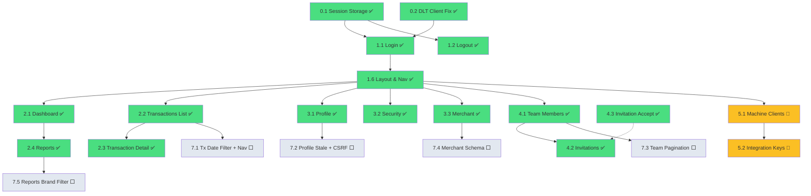

# DLT Merchant Portal — Implementation Plan & Task Specs

> **Status**: ✅ Phases 0–5 complete · Phase 7 complete · Phase 6 (hardening) queued  
> **Last updated**: 2026-10-30

---

## Project Structure (Scaffolded ✅)

```
dlt-portal/
├── GEMINI.md                           # AI coding rules (Antigravity/Gemini)
├── AGENTS.md                           # Agent instructions
├── .agents/skills/                     # AI skills
│   ├── dlt-api/SKILL.md               # DLT API integration patterns
│   ├── session-auth/SKILL.md          # Auth & session management
│   ├── security-checklist/SKILL.md    # Security review checklist
│   ├── ui-patterns/SKILL.md           # UI component patterns
│   └── error-handling/SKILL.md        # Error handling matrix
├── .kiro/steering.md                   # Kiro agent steering
├── .opencode/instructions.md          # OpenCode instructions
├── merchant-portal-api-v1.10.md       # DLT API spec (reference)
├── dlt-merchant-dashboard-spec.md     # Dashboard spec (reference)
├── package.json                        # Dependencies
├── tsconfig.json                       # TypeScript strict
├── vite.config.ts                      # Vite + Tailwind + React Router
├── react-router.config.ts             # SSR enabled
├── vitest.config.ts                    # Unit/contract tests
├── playwright.config.ts               # E2E tests
├── .env.example                        # Environment template
├── .gitignore / .prettierrc            # Tooling config
├── app/
│   ├── root.tsx                        # Root layout
│   ├── routes.ts                       # Route config
│   ├── app.css                         # Tailwind + theme
│   ├── routes/                         # All route stubs (16 files)
│   ├── .server/
│   │   ├── env.ts                      # Zod-validated env
│   │   ├── session.ts                  # Session management (stub)
│   │   ├── csrf.ts                     # CSRF protection
│   │   ├── security-headers.ts         # Security headers
│   │   ├── logger.ts                   # Structured logger with redaction
│   │   └── dlt/
│   │       ├── client.ts              # DLT fetch wrapper (timeouts, retry)
│   │       ├── errors.ts             # Error types + Result<T>
│   │       └── schemas.ts            # Zod schemas for all responses
│   ├── components/                    # (empty, to be populated)
│   └── lib/
│       ├── money.ts                   # Decimal formatting
│       ├── dates.ts                   # Luxon helpers
│       ├── filters.ts                # URL ↔ filter parsing
│       ├── csv.ts                    # Client-side CSV export
│       └── intervals.ts             # Bucket limit validation
└── tests/
    ├── unit/
    ├── contract/
    └── e2e/
```

---

## Environment Setup

Backend developer will supply these values:

| Item | Maps to | Status |
|------|---------|--------|
| Portal application client ID | `DLT_PORTAL_CLIENT_ID` | ⬜ Awaiting |
| Portal application client secret | `DLT_PORTAL_CLIENT_SECRET` | ⬜ Awaiting |
| Application code (`X-DLT-Application`) | `DLT_APPLICATION_CODE` | ⬜ Awaiting (expected: `merchant_portal`) |
| Dummy merchant user email | `E2E_ADMIN_EMAIL` | ⬜ Awaiting |
| Dummy merchant user password | `E2E_ADMIN_PASSWORD` | ⬜ Awaiting |
| `DLT_ORIGIN` (test) | `DLT_ORIGIN` for dev/staging | ⬜ Awaiting |
| `DLT_ORIGIN` (production) | `DLT_ORIGIN` for production | ⬜ Awaiting |

> [!IMPORTANT]
> Copy `.env.example` to `.env` and fill in the values before running the app.

---

## Phase 0: Foundations

### Task 0.1 — Session Storage Implementation
**File**: `app/.server/session.ts`
**Status**: ✅ Completed  
**Priority**: 🔴 Critical path

**Spec**:
1. Implement `createSessionStorage` with memory store (dev) and Redis adapter (prod)
2. PAT encryption at rest using AES-256-GCM with `SESSION_SECRETS[0]` as key
3. Support key rotation: first key encrypts, all keys decrypt
4. Session cookie: `__Host-sid`, `HttpOnly`, `Secure`, `SameSite=Lax`, `Path=/`
5. Session ID rotation at login via `commitSession` with new ID
6. Session expiry capped at PAT `expires_at` (max 60 min)
7. `requireUser(request)`: validate session + expiry, return `{ pat, user }` or redirect
8. `requireRole(user, role)`: throw 403 if role doesn't match

**Acceptance**:
- [ ] Session round-trips work (create → read → destroy)
- [ ] Encrypted PAT cannot be read from raw session data
- [ ] `requireUser` redirects to `/login?returnTo=<path>` when expired
- [ ] `requireRole('administrator')` blocks developers

---

### Task 0.2 — DLT Client Import Paths Fix
**File**: `app/.server/dlt/client.ts`
**Status**: ✅ Completed  
**Priority**: 🔴 Critical path

**Spec**:
1. Fix import paths from `~/app/.server/...` to `~/.server/...` (tsconfigPaths uses `~/*` → `./app/*`)
2. Verify all DLT client functions work with correct env imports
3. Add proper Zod parsing to `dltGet` and `dltMutate` responses

**Acceptance**:
- [ ] `tsc --noEmit` passes
- [ ] DLT client can make real requests when env is configured

---

### Task 0.3 — MSW Test Fixtures
**Files**: `tests/fixtures/`, `tests/contract/`  
**Status**: ✅ Completed  
**Priority**: 🟡 Important

**Spec**:
1. Extract JSON response examples from `merchant-portal-api-v1.10.md` into `tests/fixtures/`:
   - `login-success.json`, `profile.json`, `merchant.json`, `transaction-list.json`
   - `transaction-detail.json`, `history-list.json`, `metrics.json`, `charts.json`
   - `team-members.json`, `invitations.json`, `machine-clients.json`
   - `integration-keys.json`, `currency-catalogue.json`
   - Error fixtures: `401-invalid-credentials.json`, `422-validation.json`, `429-rate-limited.json`
2. Create MSW handlers in `tests/mocks/handlers.ts`
3. Contract tests: each fixture must parse through its Zod schema

**Acceptance**:
- [x] All fixtures parse through their Zod schemas
- [x] MSW handlers respond correctly for happy path + errors

---

### Task 0.4 — Smoke Test Script
**File**: `scripts/smoke-test.ts`
**Status**: ✅ Completed  
**Priority**: 🟡 Important

**Spec**:
1. Uses `DEV_SMOKE_PAT` env var (or falls back to login with `E2E_ADMIN_*`)
2. Calls `GET /api/v1/portal/me` with Bearer token
3. Prints: connection status, user info, merchant info
4. Validates response with Zod schema
5. Exits 0 on success, 1 on failure

**Acceptance**:
- [ ] Script succeeds against test DLT deployment
- [ ] Verifies origin and connectivity are working

---

### Task 0.5 — Security Headers Middleware
**Files**: `app/root.tsx`, `app/.server/security-headers.ts`
**Status**: ✅ Completed  
**Priority**: 🟡 Important

**Spec**:
1. Generate CSP nonce per request
2. Apply security headers to all responses via root route's `headers` export
3. `Cache-Control: no-store` on authenticated responses
4. Integrate nonce into `<Scripts nonce={nonce} />`

**Acceptance**:
- [ ] All security headers present in responses
- [ ] CSP nonce changes per request
- [ ] No inline scripts without nonce

---

## Phase 1: Access (Login/Logout/Password Recovery)

### Task 1.1 — Login Page
**File**: `app/routes/public.login.tsx`  
**Status**: ✅ Completed  
**Priority**: 🔴 Critical path  
**Depends on**: 0.1, 0.2

**Spec**:
1. Form: email + password + CSRF token (hidden input)
2. Action flow:
   - Validate CSRF (Origin check + token)
   - Call `POST /api/v1/auth/login` via `dltLoginCall()`
   - On success: call `GET /portal/me` for canonical role
   - Create session with `{ pat, expiresAt, user, csrfSecret }`
   - Redirect to `returnTo` (validated as same-origin relative) or `/`
3. Error mapping per spec §6.1:
   - `401 INVALID_CREDENTIALS` → inline "Wrong email or password"
   - `401 ECOSYSTEM_CLIENT_UNAUTHENTICATED` → "Service unavailable" (NOT user error)
   - `403` → "Your account isn't eligible"
   - `429` → show retry delay
   - `503` → "Service temporarily unavailable"
4. Handle `?reason=expired` and `?reason=password_changed` query params for info banners
5. Disable submit while pending

**Acceptance**:
- [x] Login works with dummy merchant credentials
- [x] Wrong password shows inline error
- [x] Session created with correct role from GET /portal/me
- [x] CSRF rejection works
- [x] Redirect to returnTo after login

---

### Task 1.2 — Logout
**File**: `app/routes/app.logout.tsx`  
**Status**: ✅ Completed  
**Priority**: 🔴 Critical path  
**Depends on**: 0.1

**Spec**:
1. POST action only (CSRF-protected)
2. Call `POST /auth/logout` with Bearer token (best effort)
3. Destroy session even if DLT call fails
4. Redirect to `/login`
5. GET /logout redirects to /

**Acceptance**:
- [x] Logout destroys session
- [x] Session destroyed even if DLT returns error
- [x] Cannot access protected routes after logout

---

### Task 1.3 — Forgot Password
**File**: `app/routes/public.forgot-password.tsx`  
**Status**: ✅ Completed  
**Priority**: 🟡 Important

**Spec**:
1. Form: email only
2. Call `POST /auth/reset-password/reset-link` with `{ email, reset_url }`
3. `reset_url` = `${APP_ORIGIN}/reset-password` (max 150 chars, no query/fragment)
4. Always show generic success message (no account existence leak)
5. Handle 429

**Acceptance**:
- [x] Generic success message always shown
- [x] 429 handled gracefully

---

### Task 1.4 — Reset Password
**File**: `app/routes/public.reset-password.tsx`  
**Status**: ✅ Completed  
**Priority**: 🟡 Important

**Spec**:
1. Client-side: read `?token&email` from URL, move to form state, strip from visible URL via `history.replaceState`
2. Form: password + password_confirmation (policy: 12-128 chars, upper+lower+number+symbol)
3. Submit to BFF action which calls `POST /auth/reset-password/new-password`
4. Success: redirect to `/login` with success notice
5. Invalid/expired token: 400 → show error, guide to request new link

**Acceptance**:
- [x] Token/email stripped from URL after page load
- [x] Password policy shown inline
- [x] Expired token shows helpful error

---

### Task 1.5 — Session Expiry UX
**Files**: `app/routes/app.layout.tsx`, `app/components/session-expiry-notice.tsx`  
**Status**: ✅ Completed  
**Priority**: 🟡 Important  
**Depends on**: 0.1

**Spec**:
1. Layout passes `expiresAt` to client
2. Client shows "Session expires in N min" notice in last 5 minutes
3. On expiry: redirect to `/login?reason=expired&returnTo=<current_path>`
4. Non-blocking (toast/banner, not modal)

**Acceptance**:
- [x] Notice appears in last 5 minutes
- [x] Auto-redirect on expiry
- [x] returnTo preserves current page

---

### Task 1.6 — App Layout & Navigation
**File**: `app/routes/app.layout.tsx`  
**Status**: ✅ Completed  
**Priority**: 🔴 Critical path  
**Depends on**: 0.1

**Spec**:
1. Left nav (collapsible on mobile): Dashboard, Transactions, Reports, Settings (group)
2. Settings sub-nav: Profile, Security, Merchant, Team, Developer
3. Developer role: same nav, admin-only controls hidden or disabled with tooltip
4. Top bar: app name, user menu (profile, security, logout)
5. "Connected to: Test API / Production API" indicator in footer
6. `requireUser()` in loader — redirect to login if not authenticated
7. Pass user data to layout context for role-based UI gating

**Acceptance**:
- [x] Navigation renders all links
- [x] Mobile hamburger menu works
- [x] Admin sees all items, Developer sees restricted items
- [x] User menu with logout works
- [x] API environment indicator visible

---

## Phase 2: Core Insight (Dashboard, Transactions, Reports)

### Task 2.1 — Dashboard Page
**File**: `app/routes/app._index.tsx`  
**Status**: ✅ Completed  
**Priority**: 🔴 Critical path  
**Depends on**: 1.1, 1.6

**Spec**:
1. Controls: currency selector, date range presets (Today, Last 7/30 days, This/Last month, Custom), timezone (more menu)
2. Loader makes 3 parallel calls: `metrics`, `charts?interval=day`, `transactions?per_page=10`
3. Currency default from `merchant.currency` (GET /portal/merchant)
4. Currency options from `GET /json/currency` (cached 1h server-side)
5. Auto-select interval: ≤62 days → day, ≤24 months → month, else year
6. Widgets per spec §9.2:
   - KPI cards: Total collected (tooltip: gross before fees), Transaction count, Success rate, Pending/Rejected counts
   - Collection trend chart (bars/area, partial buckets marked)
   - Transaction volume by status (stacked bar)
   - Success rate trend (line, null gaps)
   - Status mix (donut)
   - Recent transactions (top 10, link to /transactions)
   - Data freshness ("As of HH:mm" with tooltip)
7. Enforce bucket limits before calling API

**Acceptance**:
- [x] Dashboard loads with KPI cards and charts
- [x] Date range presets work correctly
- [x] Partial buckets visually distinct
- [x] Currency selector works
- [x] Recent transactions link to full list

---

### Task 2.2 — Transactions List
**File**: `app/routes/app.transactions._index.tsx`  
**Status**: ✅ Completed  
**Priority**: 🔴 Critical path  
**Depends on**: 1.6

**Spec**:
1. All filters URL-synced: from/to (paired), status, merchant_transaction_id, query, currency, payment_brand, page, per_page
2. Changing any filter resets to page 1
3. Debounce text filters (query, merchant_transaction_id) by 400ms
4. Columns: Merchant ref, Amount+currency, Status (badge), Payment brand, Created (timezone), History indicator
5. Row click → /transactions/:id
6. Empty result: friendly empty state + "Clear filters"
7. Pagination: 10/25/50/100 per page
8. Per-page CSV export (client-side only)
9. Sort is fixed by API — no column sorting UI

**Acceptance**:
- [x] All filters work and sync to URL
- [x] Pagination works
- [x] Filter changes reset to page 1
- [x] CSV export downloads current page
- [x] Empty state renders correctly

---

### Task 2.3 — Transaction Detail + History
**File**: `app/routes/app.transactions.$id.tsx`  
**Status**: ✅ Completed  
**Priority**: 🟡 Important  
**Depends on**: 2.2

**Spec**:
1. Summary tab: all transaction fields, status badge, amounts
2. History tab (lazy-loaded):
   - Coverage header with 4 event-kind badges (captured/not_captured/purged)
   - Timeline: event type, direction, captured_at, http_status, attempt_number, delivery state/duration
   - Expandable JSON payload viewer for `capture_status=available`
   - Omissions footnote
   - Retention footer: retain_until, purged_at
3. Wording per spec §9.4 (sanitized projections, no replay implications)
4. 404 → "Not found" (no cross-merchant hints)

**Acceptance**:
- [x] Summary shows all transaction fields
- [x] History timeline renders correctly
- [x] JSON payload viewer works
- [x] Coverage badges accurate
- [x] 404 handled gracefully

---

### Task 2.4 — Reports Page
**File**: `app/routes/app.reports.tsx`  
**Status**: ✅ Completed  
**Priority**: 🟡 Important  
**Depends on**: 2.1

**Spec**:
1. Inputs: currency (required), date range (required), timezone, optional payment_brand, interval
2. Parallel calls: `metrics` + `charts` (separate query objects, never shared)
3. Output per spec §9.5:
   - KPI strip from `charts.data.totals`
   - Charts: collection bars, status stacked, success-rate line
   - Bucket table with totals row
   - CSV download (client-side)
   - Derived analytics labeled "derived in dashboard"
   - Notes panel explaining data caveats
4. Error handling: 422 interval error → suggest coarser interval; 503 → "temporarily unavailable"

**Acceptance**:
- [x] Reports render with KPIs, charts, table
- [x] CSV export works
- [x] Interval validation prevents excessive buckets
- [x] Derived analytics clearly labeled

---

## Phase 3: Account Management

### Task 3.1 — Profile Settings
**File**: `app/routes/app.settings.profile.tsx`  
**Status**: ✅ Completed  
**Priority**: 🟡 Important

**Spec**:
1. Display: first_name, last_name, email, role (read-only), merchant (read-only)
2. Edit: PATCH sends only changed fields (first_name, last_name, email)
3. Email change → pending_email banner with OTP form (6 digits, string type)
4. OTP: 15-min expiry, max 5 attempts, then 429 → prompt resend
5. Resend button for verification code
6. Sending current email cancels pending change
7. Duplicate email → 422 with email field error
8. Email verification via link: handle `/?email_verification=verified|invalid` redirect, show toast, strip param, refetch profile

**Acceptance**:
- [x] Profile edits save correctly
- [x] Email change shows OTP form
- [x] OTP verification works
- [x] Email verification redirect handled

---

### Task 3.2 — Security (Password Change)
**File**: `app/routes/app.settings.security.tsx`  
**Status**: ✅ Completed  
**Priority**: 🟡 Important

**Spec**:
1. Form: current_password, password, password_confirmation
2. Policy: 12-128 chars, upper+lower+number+symbol (show inline)
3. Call `PUT /portal/me/password`
4. Success (`reauthentication_required: true`): destroy session → login with notice
5. Clear password fields after every attempt

**Acceptance**:
- [x] Password change works
- [x] Session destroyed after success
- [x] Policy displayed inline
- [x] Password fields cleared after each attempt

---

### Task 3.3 — Merchant Profile
**File**: `app/routes/app.settings.merchant.tsx`  
**Status**: ✅ Completed  
**Priority**: 🟡 Important

**Spec**:
1. View (both roles): name, contact person, email, phone, address, website, currency, is_active, services, logo
2. Edit (admin only): name, contact_person, email, dial_code, phone, address, website
3. Logo: upload (admin, multipart, PNG/JPEG/WebP max 2048KB), delete (204 idempotent)
4. Read-only: currency, activation, services
5. PATCH sends only changed fields (at least one required)

**Acceptance**:
- [x] Merchant profile displays all fields
- [x] Admin can edit, Developer cannot
- [x] Logo upload/delete works
- [x] Services list renders correctly

---

## Phase 4: Team Management

### Task 4.1 — Team Members
**File**: `app/routes/app.settings.team.tsx`  
**Status**: ✅ Completed  
**Priority**: 🟡 Important

**Spec**:
1. Members list (both roles): name, email, role, is_active, joined_at
2. Admin actions: change role (administrator/developer), remove member
3. `409 LAST_ADMINISTRATOR`: explain sole active admin constraint
4. Self-demotion/removal: warn, then destroy session
5. Role change/removal revokes that user's tokens: confirmation dialog

**Acceptance**:
- [x] Members list renders for all roles
- [x] Admin can change role and remove members
- [x] LAST_ADMINISTRATOR handled with clear explanation
- [x] Self-demotion/removal destroys session
- [x] Confirmation dialog shown before mutations

---

### Task 4.2 — Invitations
**File**: `app/routes/app.settings.team.tsx` (invitations tab)  
**Status**: ✅ Completed  
**Priority**: 🟡 Important

**Spec**:
1. Admin only: list with status filter, invite (email + role), resend, revoke
2. `201 sent:false`: show "Saved, email not sent; Resend" — do NOT auto-create another
3. 48h validity
4. Handle all conflict codes (409, 410)

**Acceptance**:
- [x] Invitations list with status filter works
- [x] Invite form (email + role) renders and submits
- [x] sent:false shows warning with Resend prompt
- [x] 409 MEMBER_ALREADY_EXISTS and INVITATION_ALREADY_PENDING handled
- [x] Resend and revoke actions work

---

### Task 4.3 — Invitation Acceptance Page
**File**: `app/routes/public.team.invitations.accept.tsx`  
**Status**: ✅ Completed  
**Priority**: 🟡 Important

**Spec**:
1. Read `#token=` from fragment on client (never reaches server logs)
2. Two forms: new account (names + password) / existing (current_password only)
3. BFF calls with Basic app credentials (not Bearer)
4. Success: redirect to /login (no PAT returned)
5. 410: "Ask admin to resend"; do not resubmit

**Acceptance**:
- [x] Token read from URL fragment, stripped from address bar
- [x] New account flow with password policy feedback
- [x] Existing account flow (current_password only)
- [x] 410 terminal state — no re-submit possible
- [x] Success redirects to /login

---

## MVP Dependency Graph



> [!NOTE]
> 🟢 Green = Completed. 🟡 Yellow = MVP remaining. Solid arrows = hard dependency. Dashed = soft/parallel.

---

## Future Implementation (Post-MVP)

> [!IMPORTANT]
> The following items are **out of scope for the MVP** and will be addressed in future iterations.

### Phase 5: Developer Credentials

#### Task 5.1 — Machine API Clients
**File**: `app/routes/app.settings.developer.tsx`  
**Status**: ✅ Completed  
**Priority**: 🟡 Important  
**Spec**: [.kiro/specs/feat-developer-settings.md](./../.kiro/specs/feat-developer-settings.md)

**Spec**:
1. List (both roles): label, is_active, created, last used, revoked, rotation deadline, replaces
2. Admin: issue (label, reason, current_password), rotate (+overlap_minutes), revoke (reason, current_password)
3. Secret handover: consume delivery → one-time reveal (client_id, client_secret, grant_type, token_url)
4. One-time secret rules: never stored, cleared on navigation, copy-to-clipboard + "I have stored it"
5. No automatic retry after timeout — refetch client list first
6. Revocation: type-to-confirm dialog

**Acceptance**:
- [ ] Loader fetches machine clients list (paginated) and integration keys in parallel
- [ ] List shows label, status, created_at, last_used_at, rotation_deadline_at, replaces
- [ ] Pagination uses `setSearchParams` (no hard reload)
- [ ] Admin: issue form validates label, reason, current_password
- [ ] Admin: on issue success, consume-secret dialog opens immediately
- [ ] Admin: secret reveal is masked by default, copy button provided, checkbox gates close
- [ ] Admin: secret cleared from state on dialog close
- [ ] Admin: rotate form validates overlap_minutes (5–10080)
- [ ] Admin: 409 on rotate shows friendly message
- [ ] Admin: revoke requires typing the label to confirm
- [ ] Developer: sees list metadata only, no mutation buttons

---

#### Task 5.2 — Integration Keys
**File**: `app/routes/app.settings.developer.tsx` (integration keys section)  
**Status**: ✅ Completed  
**Priority**: 🟡 Important  
**Spec**: [.kiro/specs/feat-developer-settings.md](./../.kiro/specs/feat-developer-settings.md)

**Spec**:
1. Show presence flags (has_authentication_token, has_secret_key) + updated_at
2. Values can never be read back
3. Admin: replace (value ≤ 4096 chars, reason, current_password) or delete (204 with JSON body)
4. Explain: secret_key signs webhook notifications

**Acceptance**:
- [ ] Both key types shown with presence status and `updated_at`
- [ ] Admin: replace/set form uses `<textarea>` for value
- [ ] Admin: delete requires confirmation with reason + password
- [ ] Page revalidates after any key mutation
- [ ] Developer: sees presence flags only, no buttons

---

### Phase 6: Hardening

#### Task 6.1 — Accessibility Audit
- WCAG 2.1 AA pass
- Keyboard-navigable tables and dialogs
- Status shown by text AND color
- Responsive down to 360px

#### Task 6.2 — Performance
- `shouldRevalidate` optimization per route
- Currency catalogue cached server-side (1h)
- No unnecessary refetches after mutations

#### Task 6.3 — Logging & Alerting
- Structured JSON logs with redaction
- Alert on `ECOSYSTEM_CLIENT_UNAUTHENTICATED` and `TOKEN_ISSUER_MISCONFIGURED`
- Request ID correlation

#### Task 6.4 — Security Review
- Full checklist from `.agents/skills/security-checklist/SKILL.md`
- grep build output for leaked secrets
- Pen-test checklist walkthrough

---

## Phase 7: Audit Fixes & Polish

> Findings from 2026-10-30 audit of the completed MVP. Prioritised by user impact.  
> All specs in `.kiro/specs/`.

### Task 7.1 — Transaction Date Range Filter + Row Navigation
**File**: `app/routes/app.transactions._index.tsx`  
**Status**: ✅ Completed  
**Priority**: 🔴 P1  
**Spec**: [.kiro/specs/fix-transaction-list-ux.md](./../.kiro/specs/fix-transaction-list-ux.md)

**Fixes**:
- FIX-01: Add `From` / `To` date inputs to the transaction filter bar
- FIX-02: Replace `window.location.href` row click with `useNavigate`

**Acceptance**:
- [ ] Date range inputs render in the filter bar; setting both sends `from`/`to` to the API as ISO instants
- [ ] Clearing either date clears both from URL params
- [ ] Row click uses `useNavigate` — no full page reload
- [ ] Keyboard navigation works on table rows (`Enter`/`Space`)

---

### Task 7.2 — Profile Stale State After OTP + CSRF Audit
**Files**: `app/routes/app.settings.profile.tsx`, `app/.server/csrf.ts`  
**Status**: ✅ Completed  
**Priority**: 🔴 P1 (stale state) · 🟡 P2 (CSRF audit)  
**Spec**: [.kiro/specs/fix-profile-stale-state.md](./../.kiro/specs/fix-profile-stale-state.md)

**Fixes**:
- FIX-03: Trigger `useRevalidator` after successful `verify_otp` and `resend_otp` actions so the loader re-fetches the fresh profile
- FIX-03: Persist the `email_verification` banner value in `useState` so it survives the revalidation that strips the URL param
- FIX-05: Audit `csrf.ts` — confirm `validateCsrfToken` uses HMAC derivation, not plain equality; remediate if needed

**Acceptance**:
- [ ] Pending-email banner disappears immediately after OTP verification succeeds
- [ ] Email field reflects newly verified address after revalidation
- [ ] `email_verification=verified` banner remains visible during profile refresh
- [ ] CSRF mechanism documented; HMAC derivation confirmed or implemented

---

### Task 7.3 — Team Pagination Client-Side Navigation
**File**: `app/routes/app.settings.team.tsx`  
**Status**: ✅ Completed  
**Priority**: 🟡 P2  
**Spec**: [.kiro/specs/fix-team-pagination.md](./../.kiro/specs/fix-team-pagination.md)

**Fix**:
- FIX-04: Replace `<a href>` pagination links in `MembersTab` and `InvitationsTab` with `setSearchParams` calls

**Acceptance**:
- [ ] Members and Invitations pagination does not cause full page reloads
- [ ] Tab state, status filter, and other params are preserved on pagination

---

### Task 7.4 — Merchant Schema + Dead Code Cleanup
**Files**: `app/.server/dlt/schemas.ts`, `app/.server/dlt/collections.ts`  
**Status**: ✅ Completed  
**Priority**: 🟢 P3  
**Spec**: [.kiro/specs/fix-merchant-schema.md](./../.kiro/specs/fix-merchant-schema.md)

**Fixes**:
- FIX-06: Add `logo_url: z.string().nullable()` to `merchantSchema`
- FIX-07: Remove the exported-but-unused `getHistoryItem` function

**Acceptance**:
- [ ] `merchantSchema` includes `logo_url`
- [ ] `getHistoryItem` removed; `tsc --noEmit` passes
- [ ] Contract tests pass

---

### Task 7.5 — Reports `payment_brand` Filter UI
**File**: `app/routes/app.reports.tsx`  
**Status**: ✅ Completed  
**Priority**: 🟢 P3

**Fix**:
- FIX-09: Add a `payment_brand` text input to the Reports page filter controls (the server module already passes it to both `getMetrics` and `getCharts`)

**Acceptance**:
- [ ] `payment_brand` input renders in the Reports controls section
- [ ] Changing it updates the URL param and triggers a loader re-fetch
- [ ] Clearing it removes the param

---

### Task 7.6 — Design System Color Consistency
**Files**: All route files using `bg-blue-600`, `ring-blue-500`, `text-blue-*` as interactive colors  
**Status**: ✅ Completed  
**Priority**: 🟢 P3

**Fix**:
- FIX-08: Replace Tailwind `blue-*` interactive color classes with `primary-*` design system tokens where they represent primary actions (buttons, active nav, focus rings). Leave semantic uses of blue alone (e.g. info banners).

**Scope**:
- Primary CTA buttons: `bg-blue-600` → `bg-primary-600`, `hover:bg-blue-700` → `hover:bg-primary-700`
- Active nav links: `bg-blue-50 text-blue-700` → `bg-primary-50 text-primary-700`
- Focus rings: `focus:ring-blue-500` → `focus:ring-primary-500`
- Active tab/preset indicators: `bg-blue-600 text-white` → `bg-primary-600 text-white`
- Leave as-is: error banners, informational blue boxes, chart colors

**Acceptance**:
- [ ] All primary interactive elements use `primary-*` tokens
- [ ] `npm run dev` shows visually consistent primary color
- [ ] No design regressions on secondary/semantic blue uses

---

## Updated Dependency Graph



> 🟢 Green = Complete · 🟡 Amber = In progress · ⬜ Grey = Not started

---

## Quick Start

```bash
# 1. Install dependencies
npm install

# 2. Copy and configure environment
cp .env.example .env
# Fill in DLT credentials from backend developer

# 3. Start dev server
npm run dev

# 4. Run checks
npm run typecheck
npm run test
```
