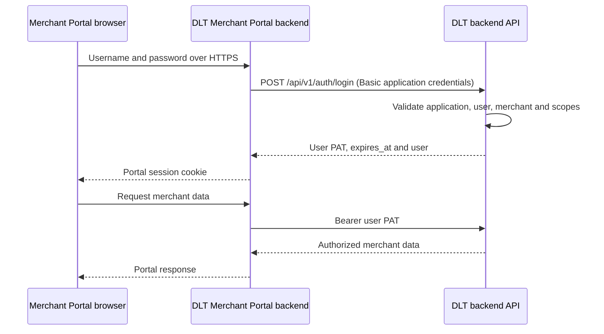

# Merchant Portal API Documentation

Version: 1.10 · Updated: 2026-10-04

Release 1.10 documents deployment-scoped collections and reporting: retired environment selectors are rejected, merchant/service and collection responses omit environment flags, and client examples and field-by-field validation references match the implemented API. See section 2.2.1 for migration guidance. This is a documentation revision; API routes remain under `/api/v1`.

Build profile, merchant, credential, team and collection screens against these DLT APIs. Collections and reporting are read-only within the selected DLT deployment, with no transaction-level test/live selector. Examples use synthetic data; obtain deployed API origins and credentials from DLT.

Contents: [Endpoints](#11-canonical-endpoint-index-for-the-portal-team) · [Conventions](#2-api-conventions) · [Authentication](#3-authentication) · [Permissions](#4-merchant-user-roles-in-the-portal) · [Profile](#5-user-profile-management) · [Merchant account](#6-merchant-account-management-in-the-portal) · [Teams](#7-team-management) · [Transactions](#8-collection-transactions--read-only) · [History](#9-transaction-history-displayed-in-the-portal) · [Reporting](#10-collection-metrics-and-chart-data) · [Errors](#11-error-handling-for-portal-consumers) · [Setup](#12-merchant-portal-setup) · [Examples](#13-merchant-portal-implementation-examples) · [Internal appendix](#14-internal-project-notes-and-references)

## 1. Endpoint reference

### 1.1 Canonical endpoint index for the Portal team

`User` = active Merchant Administrator or Developer using a user PAT. `Admin` = Merchant Administrator using that PAT. `App` = DLT Merchant Portal ecosystem application using Basic credentials and `X-DLT-Application`. Paths below are origin-relative; detailed sections define validation and responses.

| Method | Full path | Access | Input summary | Success | Details | Validation |
| --- | --- | --- | --- | --- | --- | --- |
| POST | `/api/v1/auth/login` | App + user password | `username`, `password` | 200, PAT/expiry/login user | 3.2 | [Rules](/developer/merchant-portal/authentication#validation-post-apiv1authlogin) |
| POST | `/api/v1/auth/logout` | User | No body | 200, message; current PAT revoked | 3.2 | [Rules](/developer/merchant-portal/authentication#validation-post-apiv1authlogout) |
| POST | `/api/v1/auth/reset-password/reset-link` | Public | `email`, `reset_url` | 200, account-independent message | 3.4, 13.1 | [Rules](/developer/merchant-portal/authentication#validation-post-apiv1authreset-passwordreset-link) |
| POST | `/api/v1/auth/reset-password/new-password` | Public + reset proof | `email`, `token`, `password`, `password_confirmation` | 200, message; log in afterward | 3.4, 13.1 | [Rules](/developer/merchant-portal/authentication#validation-post-apiv1authreset-passwordnew-password) |
| GET | `/api/v1/portal/me` | User | None | 200, profile | 5 | [Rules](/developer/merchant-portal/profile#validation-get-apiv1portalme) |
| PATCH | `/api/v1/portal/me` | User | At least one of first/last name/email | 200, profile, possibly pending email | 5 | [Rules](/developer/merchant-portal/profile#validation-patch-apiv1portalme) |
| POST | `/api/v1/portal/me/email/verify` | User | Six-digit string `otp` | 200, verified profile | 5.2 | [Rules](/developer/merchant-portal/profile#validation-post-apiv1portalmeemailverify) |
| POST | `/api/v1/portal/me/email/resend` | User | No body | 200, `data:null` | 5.2 | [Rules](/developer/merchant-portal/profile#validation-post-apiv1portalmeemailresend) |
| PUT | `/api/v1/portal/me/password` | User | Current/new/confirmation passwords | 200, reauthentication required | 5.1 | [Rules](/developer/merchant-portal/profile#validation-put-apiv1portalmepassword) |
| GET | `/api/v1/portal/merchant` | User | None | 200, merchant profile | 6.1 | [Rules](/developer/merchant-portal/merchant#validation-get-apiv1portalmerchant) |
| PATCH | `/api/v1/portal/merchant` | Admin | At least one editable business field | 200, merchant profile | 6.1 | [Rules](/developer/merchant-portal/merchant#validation-patch-apiv1portalmerchant) |
| GET | `/api/v1/portal/merchant/logo` | User | None | 200, `data.url` nullable | 6.1 | [Rules](/developer/merchant-portal/merchant#validation-get-apiv1portalmerchantlogo) |
| POST | `/api/v1/portal/merchant/logo` | Admin | Multipart `file` | 200, `data.url` | 6.1 | [Rules](/developer/merchant-portal/merchant#validation-post-apiv1portalmerchantlogo) |
| DELETE | `/api/v1/portal/merchant/logo` | Admin | No body | 204, empty body | 6.1 | [Rules](/developer/merchant-portal/merchant#validation-delete-apiv1portalmerchantlogo) |
| GET | `/api/v1/portal/merchant/machine-clients` | User | `page`, `per_page` | 200, paginated metadata | 6.2 | [Rules](/developer/merchant-portal/merchant#validation-get-apiv1portalmerchantmachine-clients) |
| POST | `/api/v1/portal/merchant/machine-clients` | Admin | `label`, `reason`, `current_password` | 201, client and delivery metadata | 6.2 | [Rules](/developer/merchant-portal/merchant#validation-post-apiv1portalmerchantmachine-clients) |
| POST | `/api/v1/portal/merchant/machine-clients/{client}/rotate` | Admin | Issue fields + `overlap_minutes` | 201, replacement and delivery metadata | 6.2 | [Rules](/developer/merchant-portal/merchant#validation-post-apiv1portalmerchantmachine-clientsclientrotate) |
| POST | `/api/v1/portal/merchant/machine-clients/{client}/revoke` | Admin | `reason`, `current_password` | 200, revoked metadata | 6.2 | [Rules](/developer/merchant-portal/merchant#validation-post-apiv1portalmerchantmachine-clientsclientrevoke) |
| POST | `/api/v1/portal/merchant/credential-deliveries/{delivery}/consume` | Issuing Admin | `current_password` | 200, one-use credential document | 6.2 | [Rules](/developer/merchant-portal/merchant#validation-post-apiv1portalmerchantcredential-deliveriesdeliveryconsume) |
| GET | `/api/v1/portal/merchant/integration-keys` | User | None | 200, presence metadata | 6.3 | [Rules](/developer/merchant-portal/merchant#validation-get-apiv1portalmerchantintegration-keys) |
| PUT | `/api/v1/portal/merchant/integration-keys/{keyType}` | Admin | `value`, `reason`, `current_password` | 200, presence metadata | 6.3 | [Rules](/developer/merchant-portal/merchant#validation-put-apiv1portalmerchantintegration-keyskeytype) |
| DELETE | `/api/v1/portal/merchant/integration-keys/{keyType}` | Admin | JSON `reason`, `current_password` | 204, empty body | 6.3 | [Rules](/developer/merchant-portal/merchant#validation-delete-apiv1portalmerchantintegration-keyskeytype) |
| GET | `/api/v1/portal/team/members` | User | `page`, `per_page` | 200, paginated members | 7.3 | [Rules](/developer/merchant-portal/team#validation-get-apiv1portalteammembers) |
| PATCH | `/api/v1/portal/team/members/{member}/role` | Admin | `role` | 200, updated member | 7.3 | [Rules](/developer/merchant-portal/team#validation-patch-apiv1portalteammembersmemberrole) |
| DELETE | `/api/v1/portal/team/members/{member}` | Admin | No body | 204, membership removed | 7.3 | [Rules](/developer/merchant-portal/team#validation-delete-apiv1portalteammembersmember) |
| GET | `/api/v1/portal/team/invitations` | Admin | `page`, `per_page`, optional `status` | 200, paginated invitations | 7.2 | [Rules](/developer/merchant-portal/team#validation-get-apiv1portalteaminvitations) |
| POST | `/api/v1/portal/team/invitations` | Admin | `email`, `role` | 201, invitation + `sent` | 7.2 | [Rules](/developer/merchant-portal/team#validation-post-apiv1portalteaminvitations) |
| POST | `/api/v1/portal/team/invitations/{invitation}/resend` | Admin | No body | 200, invitation + `sent` | 7.2 | [Rules](/developer/merchant-portal/team#validation-post-apiv1portalteaminvitationsinvitationresend) |
| DELETE | `/api/v1/portal/team/invitations/{invitation}` | Admin | No body | 204, invitation revoked | 7.2 | [Rules](/developer/merchant-portal/team#validation-delete-apiv1portalteaminvitationsinvitation) |
| POST | `/api/v1/portal/team/invitations/accept` | App + emailed proof | New/existing account acceptance body | 200, member; no PAT | 7.2, 13.1 | [Rules](/developer/merchant-portal/team#validation-post-apiv1portalteaminvitationsaccept) |
| GET | `/api/v1/portal/collections/transactions` | User | Optional list filters/pagination | 200, paginated transactions | 8.1 | [Rules](/developer/merchant-portal/transactions#validation-get-apiv1portalcollectionstransactions) |
| GET | `/api/v1/portal/collections/transactions/{transaction}` | User | No query/body fields | 200, transaction | 8.1 | [Rules](/developer/merchant-portal/transactions#validation-get-apiv1portalcollectionstransactionstransaction) |
| GET | `/api/v1/portal/collections/transactions/{transaction}/history` | User | Optional pagination | 200, paginated history + coverage | 9.1 | [Rules](/developer/merchant-portal/history#validation-get-apiv1portalcollectionstransactionstransactionhistory) |
| GET | `/api/v1/portal/collections/transactions/{transaction}/history/{history}` | User | No query/body fields | 200, history item | 9.1 | [Rules](/developer/merchant-portal/history#validation-get-apiv1portalcollectionstransactionstransactionhistoryhistory) |
| GET | `/api/v1/portal/collections/metrics` | User | Required currency/from/to; optional timezone/brand | 200, summary | 10.1–10.2 | [Rules](/developer/merchant-portal/reporting#validation-get-apiv1portalcollectionsmetrics) |
| GET | `/api/v1/portal/collections/charts` | User | Summary filters + required `interval` | 200, buckets and overall totals | 10.3 | [Rules](/developer/merchant-portal/reporting#validation-get-apiv1portalcollectionscharts) |

Use `{client}` from a machine-client metadata item's ownership `id`, not `oauth_client_id`; `{delivery}` and `{invitation}` are UUIDs. `{member}` is the user ID from the member list. `{transaction}` is the internal numeric transaction `id`, not the merchant reference. `{history}` is the evidence ULID from the history list. `{keyType}` is exactly `authentication_token` or `secret_key`. Do not send these route IDs again in JSON/query overrides.

The signed email-verification URL in section 5.2 is a DLT web capability outside `/api/v1`, supplied by email rather than constructed by the Portal. This index covers the DLT APIs consumed by Merchant Portal. Merchant-owned application authentication is documented separately in the [Merchant integrations guide](/developer/merchant-integrations/authentication).

## 2. API conventions

Portal endpoints use the envelopes below. Timestamps are ISO 8601 with explicit offsets; money is a decimal string. Authentication and public reset endpoints have their own documented response shapes.

### 2.1 Addresses and headers

Use a deployment-provided `DLT_ORIGIN`, for example `https://dlt.example.com`. The example hostname is not a deployed service.

| Purpose | Base path |
| --- | --- |
| Portal login, password recovery and shared currency lookup | `{DLT_ORIGIN}/api/v1` |
| Implemented Portal APIs | `{DLT_ORIGIN}/api/v1/portal` |

Paths beginning `/auth`, `/portal` or `/json` in the detailed tables are relative to `/api/v1`. The canonical index uses full `/api/v1/...` paths. The signed email-verification web path is relative to the origin. Do not prepend `/api/v1` twice.

Send `Accept: application/json`. Send `Content-Type: application/json` for JSON bodies and multipart form data for logo uploads. Let the HTTP client generate multipart boundaries.

Protected calls use:

```http
Authorization: Bearer <access_token>
Accept: application/json
```

### 2.2 Merchant identity and deployment

Implemented Portal APIs derive the merchant from the user token and accept no merchant selector. A user belongs to one merchant, matching the current `User.merchant_id` model. Multi-merchant switching is outside this version.

Collection list/detail/history/summary/chart endpoints use the authenticated merchant and the DLT deployment. There is no transaction environment selector. Staging and production use their respective DLT hosts and APN notification registrations; `environment`, `env` and `is_production` are rejected as unexpected fields. Historical transactions remain readable regardless of their retired flags.

### 2.2.1 Migration from transaction environment selectors

Update existing Portal clients as follows:

1. Configure the DLT API base URL and credentials for the intended staging or production deployment. Staging and production remain separate deployments; merchant onboarding and individual transactions no longer carry a caller-selected mode.
2. Remove `environment`, `env` and `is_production` from collection list, detail, history, metrics and chart requests. These fields are rejected as unexpected input with `422 VALIDATION_ERROR` on authorized requests. Detail endpoints accept no query/body fields; history lists accept only pagination. Keep the endpoint-specific filters documented below.
3. Stop reading `is_production` from merchant accounts or their service assignments, and stop reading `environment` from collection transactions, history, metrics and chart responses. Remove live/test selectors and badges from Portal screens. Merchant ownership, membership, scope and service activation remain enforced.
4. Treat historical transactions as part of the authorized merchant's stored collection history, regardless of their retired classification. Reset pagination and discard stale responses when supported filters change.

Endpoint paths stay under `/api/v1`. This update changes the request/response contract; clients sending retired selectors or requiring removed response fields must be updated before using the changed deployment. Documentation publication does not itself confirm that every deployment has been upgraded.

### 2.3 Portal response contract

The canonical `/portal/*` endpoints use this success envelope unless their table specifies `204 No Content`. Login, logout and public password-reset responses have the endpoint-specific shapes documented in section 3:

```json
{
  "success": true,
  "message": "Success",
  "data": {}
}
```

Paginated Portal collections use `data` as an array and include `meta`:

```json
{
  "success": true,
  "message": "Success",
  "data": [],
  "meta": {
    "current_page": 1,
    "per_page": 25,
    "total": 0,
    "last_page": 1
  }
}
```

Unless overridden below, `page` defaults to 1 and `per_page` to 25; both are positive integers, with `per_page` capped at 100. Empty collections return `200` with an empty array. A missing individual resource returns `404`.

Portal credential consumption returns JSON under `data` as documented in section 6.2. Never call `response.json()` on a `204` response.

Portal timestamps use ISO 8601 with an explicit offset; null timestamps are meaningful. Money is a decimal string paired with a currency; do not perform financial arithmetic using JavaScript floating-point numbers. Counts are integers; percentage values are decimal strings in percentage points from 0 to 100, or null for empty populations. Different timestamp serializers may emit `Z`, `+00:00`, other offsets or fractional seconds; parse as instants rather than assuming one fixed string format.

### 2.4 Request and client parsing rules

Send only documented inputs. Most Portal mutation and collection/history/reporting Form Requests reject unexpected fields; endpoint validation tables specify exceptions such as password change and metadata lists. Send only documented inputs even when extras are ignored. GET filters belong in the query string, not a JSON body. JSON PATCH submits only changed allowed fields; omission preserves stored values, while null is accepted only where specifically documented. Profile/merchant empty PATCH bodies are invalid. Integration-key DELETE requires its documented JSON body; logo/member/invitation DELETE requests do not.

Build queries with a URL encoder such as `URLSearchParams`. A literal `+` in an offset or dial code must not become a space. Route identifiers are opaque resource references: use returned values and URL-encode dynamic path segments; never derive another resource's ID from a displayed reference. Numeric IDs are currently serialized by Laravel as numbers; do not perform arithmetic on them. If deployed IDs can exceed JavaScript's safe integer range, agree an exact-integer parser or string transport with the DLT team rather than silently rounding them.

Nullable values are not errors: absent logo, pending email/expiry, legacy transaction amount/currency/brand/method/timestamps, optional delivery metadata and omitted historical payloads all have documented null behavior. Treat an empty array, missing individual resource and unavailable service distinctly. Transaction `status` is already normalized; do not recompute it from legacy flags or history HTTP status. Profile/member roles use lowercase strings; login's existing user projection uses numeric roles (see section 4).

The DLT backend API does not implement the Merchant Portal browser's cookie session, CSRF token endpoint, routing, UI or logout cookie cleanup. These are responsibilities of DLT Merchant Portal within the same DLT ecosystem. Bearer-token DLT calls and cookie-authenticated browser-to-Portal calls are separate transports.

### 2.5 Request validation conventions

Validation tables list every documented input’s location, required/optional state, type, size, permitted values and cross-field rules. Optional means omit the field; it does not automatically permit null or an empty value. Required fields and fields marked “required if supplied” reject null/empty values. Only explicitly nullable fields accept null. Send strings as JSON strings and upload images as multipart files. Query pagination/interval values are validated as integers where stated; URL values arrive as text. String limits are character counts; upload limits are KB.

Laravel trims most input strings and converts empty strings to null before validation. Password fields are not trimmed. The integration-key `value` preserves surrounding spaces, but a whitespace-only value still fails the required rule. Avoid sending placeholder angle-bracket values literally: replace them with real credentials, valid proofs or passwords satisfying the relevant policy.

For partial updates, supply at least one allowed field and omit unchanged fields. Fields such as role, ownership, activation, secrets and verification state cannot be injected into profile/merchant PATCH requests. Extra-field behavior is endpoint-specific: the tables explicitly distinguish validators that reject unlisted fields from older/list controllers that ignore them. Ignored fields grant no additional capability. GET examples use query parameters and no request body. Integration-key DELETE requires JSON; the other documented DELETE requests accept no body fields.

Route identifiers belong only in the path. Resource ownership, account state, password proof and permissions are checked in addition to format validation. These can produce 401/403/404/409/410/429/503 instead of a field-validation error; use each endpoint’s contract. A conflicting merchant selector may be rejected before request validation. Frontend checks help users complete forms; the server remains authoritative.

| Header | Requirement | Validation/behavior |
| --- | --- | --- |
| `Accept` | Use `application/json` | Requests documented here expect JSON API success/errors. |
| `Content-Type` | JSON mutations: `application/json`; logo: multipart with generated boundary | OAuth machine grant uses `application/x-www-form-urlencoded` in the separate integrations guide. |
| `Authorization` for login/acceptance | HTTP Basic with the Portal application client ID and plaintext secret | Literal `Basic ` prefix; strict Base64 of a nonempty `client_id:client_secret` pair; must match a usable registered confidential ecosystem web client. |
| `X-DLT-Application` for login/acceptance | `merchant_portal` | Trimmed application code must match the Basic-authenticated registration; acceptance explicitly requires this application. |
| `Origin` for login/acceptance | Optional | If nonempty, must exactly match the registered origin allowlist after trailing-slash normalization. No wildcard matching. |
| `Authorization` for protected APIs/logout | `Bearer <user_pat>` | Valid, unexpired, unrevoked PAT for an active eligible merchant user/application with required scope; permissions remain endpoint-specific. |

Portal body/query validation failures return 422 with `error_code=VALIDATION_ERROR` and an `errors` object keyed by field (arrays of messages). For example, an empty profile PATCH returns:

```json
{
  "success": false,
  "error_code": "VALIDATION_ERROR",
  "message": "Validation error",
  "errors": {
    "profile": [
      "Supply at least one profile field."
    ]
  }
}
```

Login and public password-reset validators retain their legacy 422 `success/message/errors` shape without `error_code`; reset-link uses message `Validation error.`, while login/new-password use `Validation error`. OAuth grants return OAuth errors. Do not apply one error parser to all guides. Field-level messages are server feedback, not stable machine codes.

Every endpoint in the [canonical index](/developer/merchant-portal/endpoints) links to its validation table. The signed email link (5.3) and currency lookup (12.1) also document their input rules.

## 3. Authentication

### 3.1 Portal application identity and user access

DLT Merchant Portal is a DLT-owned ecosystem application used by businesses registered with DLT. In this guide, **merchant** means the registered business, and **Portal user** means a person authorized to manage that business through DLT Merchant Portal.

Portal API consumption involves two credentials:

| Credential | Identifies | Used by the DLT Merchant Portal backend for |
| --- | --- | --- |
| Portal ecosystem application client ID/secret | DLT Merchant Portal itself | HTTP Basic authentication at login and invitation acceptance, with `X-DLT-Application: merchant_portal` |
| User personal access token (PAT) | The signed-in merchant user | Bearer authentication for protected Portal APIs and logout |

DLT provisions the Portal application identity. Successful login issues a user PAT after validating the application, user and merchant. The backend API resolves merchant access from that user and enforces the required role and `merchant-portal` scope. The Portal backend keeps both credentials in server-side storage.

Credentials managed on the Portal's merchant account screens are account assets, not additional Portal authentication methods. Section 6 documents those management APIs. Authentication by merchant-owned applications has its own [Merchant integrations guide](/developer/merchant-integrations/authentication).

### 3.2 Portal login

Merchant Portal is DLT's own frontend within the DLT ecosystem, paired with the DLT backend/back office. DLT merchants use it to manage their accounts. In this flow, the browser displays DLT Merchant Portal; it does not represent a merchant-owned website or mobile application.



Use Merchant Portal browser → DLT Merchant Portal backend → DLT backend API. Keep application credentials and the user PAT on the backend; use Secure/HttpOnly cookies and CSRF protection for the browser session.

**Request:**

```http
POST /api/v1/auth/login
Authorization: Basic <base64(ecosystem_client_id:ecosystem_client_secret)>
X-DLT-Application: merchant_portal
Accept: application/json
Content-Type: application/json

{
  "username": "merchant.admin@example.com",
  "password": "<user_password>"
}
```

| Input | Existing validation/behavior |
| --- | --- |
| `username` | Required string, maximum 255 characters; searched against username or email |
| `password` | Required string, minimum 6 and maximum 128 characters; existing shorter passwords retain login compatibility |
| `Authorization` | HTTP Basic credentials for the active DLT Merchant Portal ecosystem application |
| `X-DLT-Application` | `merchant_portal`, matching the supplied Portal application client ID |
| `Origin` | If supplied, must match one of that application's allowed origins |

Login requires an active merchant and an active Administrator (`1`) or Developer (`10`). DLT provisions the confidential application and PAT issuer; protected Portal calls require the `merchant-portal` scope.

**200 response example:**

```json
{
  "success": true,
  "message": "Success",
  "data": {
    "access_token": "<user_passport_personal_access_token>",
    "token_type": "Bearer",
    "expires_at": "2026-10-01T10:00:00+00:00",
    "user": {
      "id": 42,
      "reference_id": "USR_EXAMPLE",
      "merchant_reference_id": "MER_EXAMPLE",
      "merchant_id": 7,
      "first_name": "Alex",
      "last_name": "Reyes",
      "role": 1,
      "email": "merchant.admin@example.com",
      "email_verified_at": "2026-09-01T00:00:00.000000Z",
      "created_at": "2026-09-01T00:00:00.000000Z"
    }
  }
}
```

PAT lifetime defaults to **60 minutes**. Store `data.access_token` and respect the returned `data.expires_at`; no user refresh token is issued.

On expiration or `401`, clear the Portal session and require login. On `403`, handle the authorization failure rather than repeatedly retrying login.

**Logout:** `POST /api/v1/auth/logout` with the user PAT, no body. Returns `200`:

```json
{
  "success": true,
  "message": "Logged out successfully"
}
```

Logout revokes the current PAT only. Also destroy the Portal browser session.

### 3.3 Authenticated Portal requests

After login, the DLT Merchant Portal backend reads the user PAT from its server-side session and sends it to the DLT backend API:

```http
GET /api/v1/portal/me
Authorization: Bearer <user_pat>
Accept: application/json
```

The browser uses its Portal session cookie when calling the Portal backend. The backend API uses the PAT to resolve the current user, merchant and permissions. Do not send a merchant selector or repeat the application Basic credentials on protected Portal requests.

When the PAT expires or is revoked, clear the Portal session and require login again. This flow does not issue a refresh token.

### 3.4 Password recovery and change

| Method and path | Authentication | Body | Success |
| --- | --- | --- | --- |
| `POST /auth/reset-password/reset-link` | Public | `email`, `reset_url` | `200`, generic account-independent message |
| `POST /auth/reset-password/new-password` | Public reset token | `email`, `token`, `password`, `password_confirmation` | `200`, new password saved |
| `PUT /portal/me/password` | Administrator or Developer user PAT with portal eligibility | `current_password`, `password`, `password_confirmation` | `200`, portal envelope with `reauthentication_required=true` |

Reset-link validation: email maximum 255 characters; URL maximum 150 characters, matching the configured Merchant Portal origin, without URL credentials, query, or fragment. DLT appends the reset token and email. Password reset tokens use the configured password broker; this checkout sets expiry to 60 minutes.

New passwords require **12–128 characters**, uppercase and lowercase letters, numbers, symbols and matching confirmation. Current passwords have a maximum of 128 characters. Login retains its 6-character minimum for existing accounts.

Successful password change/reset revokes all user tokens and requires login. Invalid, expired or consumed reset proofs return `400`. New-account invitations use the same new-password policy.

### 3.5 Authentication failures and throttling

| HTTP | Existing error code | Meaning |
| --- | --- | --- |
| 401 | `ECOSYSTEM_CLIENT_UNAUTHENTICATED` | Application code/credentials/origin eligibility failed |
| 401 | `INVALID_CREDENTIALS` | Username/password failed |
| 401 | `UNAUTHENTICATED` / `ACCESS_TOKEN_INVALID` | Protected-route token invalid, expired, revoked, or absent |
| 403 | `MERCHANT_USER_NOT_AUTHORIZED` | Merchant user or merchant is not eligible |
| 403 | `ECOSYSTEM_APPLICATION_NOT_AUTHORIZED` | Token's ecosystem application is not eligible |
| 403 | `ACCESS_TOKEN_SCOPE_INSUFFICIENT` | User token lacks required application scope |
| 403 | `MERCHANT_SCOPE_MISMATCH` | Supplied merchant identifier differs from authenticated merchant |
| 503 | `TOKEN_ISSUER_MISCONFIGURED` | Personal-access token issuer does not match application |

Existing application API throttling defaults to 60 requests/minute per resolved user ID or IP. Public routes also have a 30/minute limiter. Login additionally defaults to 5 attempts/minute keyed by application, submitted identity, and IP. These are configured code defaults; deployment configuration can change them. Respect `429` and any `Retry-After` header.

### 3.6 Authentication/header matrix for implementation

| Call | Authorization | Additional headers | Credential holder |
| --- | --- | --- | --- |
| Login | Basic Portal application client ID/secret | `X-DLT-Application: merchant_portal`, Accept/JSON content type | Portal backend |
| Invitation acceptance | Same Basic Portal application credentials | Same application header, Accept/JSON content type | Portal backend; submit emailed proof separately in JSON |
| Protected Portal APIs and logout | Bearer user PAT | Accept; JSON content type when sending JSON, multipart for logo | Portal backend acting for the logged-in user |
| Public password reset | No Basic/Bearer required by these routes | Accept/JSON content type | Portal backend can relay the public flow |

Use `X-DLT-Application: merchant_portal` for Portal login and invitation acceptance. Basic application authentication and the resulting user's PAT are separate credentials; after login, use Bearer for protected resource requests rather than repeating Basic login credentials. The same `Authorization` header cannot hold both schemes. If sending `Origin` to login/acceptance, it must be an allowed configured origin. A browser's session cookie alone does not authenticate it to DLT.

The DLT Merchant Portal architecture is Merchant Portal browser → DLT Merchant Portal backend → DLT backend API: keep the ecosystem secret and user PAT in server-side secret/session storage, exchange a Secure/HttpOnly browser cookie with the browser, rotate the session identifier at login and enforce CSRF on browser cookie-authenticated mutations. The browser must not call confidential login directly. The DLT Merchant Portal backend manages its browser session and cookie/CORS policies; the DLT backend API does not create or manage that session. A one-use merchant credential handover is a privileged operation described in section 6.2, not permission to persist integration secrets in frontend bundles, local storage, URLs or telemetry.

Session duration must not exceed the PAT's returned expiry. Password change/reset and actual team role/removal mutations revoke affected tokens; a successful current-user mutation can therefore be followed immediately by `401`. Clear the local session on successful self-removal/demotion or password change, and on a protected-call invalid-token response. A login `401 INVALID_CREDENTIALS` is a form error; `401 ECOSYSTEM_CLIENT_UNAUTHENTICATED` is a Portal application/provisioning failure and should not be shown as a wrong user password. No public refresh or silent renewal is available for this user PAT.

### 3.7 Request validation reference

These tables reflect the current implementation’s request rules. See [input conventions](/developer/merchant-portal/conventions#25-request-validation-conventions) for required/optional/null behavior and error formats.

#### Validation: POST /api/v1/auth/login

| Field | Location | Requirement | Validation rules |
| --- | --- | --- | --- |
| `username` | JSON body | Required | Nonempty string, maximum 255 characters; matched against stored username or email. |
| `password` | JSON body | Required | String, 6–128 characters; must match the stored password. Existing login passwords use this minimum; new/reset passwords use 12 characters. |

The current validator does not reject unlisted fields; they are not validated or used by this operation. Send only documented fields. Application headers must satisfy section 2.5. Invalid body fields return the legacy 422 validation envelope; incorrect credentials return `401 INVALID_CREDENTIALS`.

#### Validation: POST /api/v1/auth/logout

| Field | Location | Requirement | Validation rules |
| --- | --- | --- | --- |
| (none) | Body/query | No documented inputs | No payload is required; see behavior below. |

Send no request body. The controller does not validate or use payload fields. An eligible user PAT is required.

#### Validation: POST /api/v1/auth/reset-password/reset-link

| Field | Location | Requirement | Validation rules |
| --- | --- | --- | --- |
| `email` | JSON body | Required | Valid email address, maximum 255 characters. |
| `reset_url` | JSON body | Required | URL, maximum 150 characters. Scheme/host/effective port must match configured `APP_MERCHANT_URL` (default ports normalized). HTTP or HTTPS according to that configured origin; no URL username/password, query or fragment. A path is permitted; missing/invalid Portal configuration fails validation. |

The current validator does not reject unlisted fields; they are not validated or used by this operation. Send only documented fields. A nonexistent email still receives the generic success message; this is not an account-existence check.

#### Validation: POST /api/v1/auth/reset-password/new-password

| Field | Location | Requirement | Validation rules |
| --- | --- | --- | --- |
| `email` | JSON body | Required | Valid email address, maximum 255 characters; must identify the account bound to the reset proof. |
| `token` | JSON body | Required | Nonempty string, maximum 255 characters; must be the valid, unexpired proof for that email (broker expiry currently 60 minutes). |
| `password` | JSON body | Required | String, 12–128 characters; at least one letter, uppercase and lowercase letters, number and symbol. Must exactly match `password_confirmation`. |
| `password_confirmation` | JSON body | Required by confirmation | Same value as `password`; do not trim passwords. |

The current validator does not reject unlisted fields; they are not validated or used by this operation. Send only documented fields. Body validation returns the legacy 422 envelope. Invalid/expired broker proof returns 400, rather than `410`.

### 3.8 Logout and password recovery examples

The following are synthetic request/response pairs. Replace IDs and credential placeholders with values from your environment. GET requests have no body; filters belong in the query string. Examples show successful operations; validation and access rules above still apply.

#### POST /auth/logout

**Request (no body):**

```http
POST /api/v1/auth/logout
Accept: application/json
Authorization: Bearer <user_pat>
```

**Response: 200.**

```json
{
  "success": true,
  "message": "Logged out successfully"
}
```

#### POST /auth/reset-password/reset-link

**Request:**

```http
POST /api/v1/auth/reset-password/reset-link
Accept: application/json
Content-Type: application/json

{
  "email": "merchant.admin@example.com",
  "reset_url": "https://portal.example.com/reset-password"
}
```

**Response: 200.**

```json
{
  "success": true,
  "message": "If the account exists, a password reset link has been sent."
}
```

#### POST /auth/reset-password/new-password

**Request:**

```http
POST /api/v1/auth/reset-password/new-password
Accept: application/json
Content-Type: application/json

{
  "email": "merchant.admin@example.com",
  "token": "<password_reset_token>",
  "password": "<new_password>",
  "password_confirmation": "<new_password>"
}
```

**Response: 200.**

```json
{
  "success": true,
  "message": "New password has been saved."
}
```

## 4. Merchant user roles in the Portal

Administrator and Developer are roles held by users of a business registered with DLT. They describe what that user can do inside DLT Merchant Portal. Developer here is a merchant team role, not the DLT development team maintaining the Portal. DLT back-office platform roles cannot use this Portal user contract.

| Capability | Administrator | Developer |
| --- | --- | --- |
| Read/update own profile, verify own email, change own password | Yes | Yes |
| View merchant profile, logo, and enabled services | Yes | Yes |
| Update editable merchant profile and logo | Yes | No |
| View merchant integration credential metadata in the Portal | Yes | Yes |
| Manage and retrieve newly issued merchant integration credentials in the Portal | Yes | No |
| Replace/remove merchant integration keys in the Portal | Yes | No |
| View team member directory | Yes | Yes |
| List/manage invitations, change roles, remove members | Yes | No |
| Read stored transactions, sanitized merchant history, and metrics | Yes | Yes |
| Reveal additional sensitive evidence | Outside initial portal contract | Outside initial portal contract |
| Initiate or mutate collection transactions | No | No |

Login returns numeric `user.role`: `1` for Administrator, `10` for Developer. Profile/member resources return `administrator` or `developer`. Fetch `GET /portal/me` after login for the canonical role.

## 5. User profile management

### 5.1 Portal endpoints and validation

Both roles may manage their own profile. Responses use the Portal envelope and `Cache-Control: no-store`.

| Method and path | Body/query | Result |
| --- | --- | --- |
| `GET /portal/me` | None | `200`, current user and merchant identity |
| `PATCH /portal/me` | Any of `first_name`, `last_name`, `email`; at least one | `200`, updated self-profile; email may be pending |
| `POST /portal/me/email/verify` | `otp` (six decimal digits as a string) | `200`, verified profile |
| `POST /portal/me/email/resend` | None; unexpected fields rejected | `200`, sent message and `data=null` |
| `PUT /portal/me/password` | `current_password`, `password`, `password_confirmation` | `200`, revoke user tokens and require login |

Implemented profile validation: names are nonempty strings up to 50 characters; email is a valid address up to 255 characters. PATCH requires at least one allowed field and rejects unexpected fields, including role, user selector, merchant ownership, activation, and verification status. A mismatched merchant selector is rejected by merchant context with `403`; other field validation failures return `422 VALIDATION_ERROR`. Omitted fields remain unchanged. Names are trimmed; replacement email is trimmed and lowercased.

Changing email retains the current login email until verification, then changes it atomically. The replacement must be unique against other current emails, pending emails, and usernames that could collide with email-based login; uniqueness is rechecked at verification. Duplicate addresses return `422` with an `email` field error and do not change names or consume verification. Username remains unchanged. Successful email verification preserves existing PATs; password changes revoke them.

A names-only PATCH preserves any pending email. Sending the current email explicitly cancels the pending change. Sending a different replacement issues fresh proofs and invalidates previous ones. Pending records, including expired records, continue reserving their email until completed, replaced, or cancelled. Mail is sent after the database transaction; delivery failure can leave a pending change saved. Read profile state and use resend to recover.

PATCH is limited to **3/minute/user**, resend to **3/minute/user**, and OTP verification to **10/minute/user**, using separate named limiters in addition to the API-wide limit. Requests rejected by validation also consume the request limit. `429 RATE_LIMITED` caused by request throttling includes `Retry-After`.

Implemented password validation is described in section 3.4. `PUT /api/v1/portal/me/password` permits 6 requests/minute per authenticated user in addition to the API-wide throttle. It accepts no user selector. Incorrect current password, invalid length/composition, or mismatched confirmation returns `422` with `error_code=VALIDATION_ERROR` and field errors. Invalid access returns `401`; ineligible membership/application/scope returns `403`; throttling returns `429`. Validation failure leaves the password and tokens unchanged.

Request example (replace placeholders with actual passwords):

```json
{
  "current_password": "<current_password>",
  "password": "<new_password>",
  "password_confirmation": "<new_password>"
}
```

Successful response:

```json
{
  "success": true,
  "message": "Password updated. Please log in again.",
  "data": {
    "reauthentication_required": true
  }
}
```

Clear the Portal session and obtain a new PAT through normal login after password-change success.

**`GET /portal/me` data object** (also returned under `data` after PATCH and OTP verification):

```json
{
  "id": 42,
  "reference_id": "USR_EXAMPLE",
  "first_name": "Alex",
  "last_name": "Reyes",
  "username": "alex.reyes",
  "email": "merchant.admin@example.com",
  "pending_email": null,
  "pending_email_expires_at": null,
  "email_verified_at": "2026-09-01T00:00:00Z",
  "role": "administrator",
  "is_active": true,
  "merchant": {
    "id": 7,
    "reference_id": "MER_EXAMPLE",
    "name": "Example Merchant"
  }
}
```

`pending_email` and its ISO 8601 expiry are null when no replacement is pending. Password hashes, OTP hashes, attempt counters, and credential secrets are never included in this resource.

### 5.2 Email verification and Portal redirect

Example PATCH body:

```json
{
  "email": "replacement@example.com"
}
```

The new address receives the existing verification email containing a six-digit OTP and an expiring signed DLT link. Submit the OTP as a string to `POST /api/v1/portal/me/email/verify`:

```json
{
  "otp": "123456"
}
```

OTP and link expire after **15 minutes**. Incorrect OTP returns `422 VALIDATION_ERROR` and increments a persisted counter; after five incorrect attempts, subsequent verification returns `429 RATE_LIMITED` with a message requesting a new code. Both OTP and link are blocked by that counter. Missing/expired pending verification returns `422`. Resend creates a different OTP, resets the counter and expiry, and invalidates the prior signed link. Completed proofs cannot be reused.

The email link targets `GET /portal/profile/email/verify/{verification}` on the DLT web host, outside `/api/v1`. It requires Laravel's valid expiring signature plus a proof bound to the current pending record; it does not require a PAT or admin session. It rechecks active merchant membership, pending-record ownership/expiry/attempts, and email uniqueness. A signed link cannot update arbitrary fields or verify another replacement.

Successful link verification returns `302` to **`APP_MERCHANT_URL?email_verification=verified`**; a valid signature with a stale/consumed/ineligible/conflicting proof redirects with `email_verification=invalid`. Invalid, tampered, or expired signatures are rejected with `403` before redirect. The redirect includes no email, OTP, signature, or token, and uses `Cache-Control: no-store` and `Referrer-Policy: no-referrer`.

The destination is the DLT Merchant Portal URL configured as **`APP_MERCHANT_URL`**, preserving its base path. This setting refers to DLT's Portal, not the merchant business's website. Handle `email_verification` as UI feedback and fetch the profile after redirect. Missing/invalid destination configuration returns `503` and prevents new email changes.

### 5.3 Request validation reference

These tables reflect the current implementation’s request rules. See [input conventions](/developer/merchant-portal/conventions#25-request-validation-conventions) for required/optional/null behavior and error formats.

#### Validation: GET /api/v1/portal/me

| Field | Location | Requirement | Validation rules |
| --- | --- | --- | --- |
| (none) | Body/query | No documented inputs | No payload is required; see behavior below. |

Send no request body. No body/query fields are validated or used to select another user; identity comes from the PAT.

#### Validation: PATCH /api/v1/portal/me

| Field | Location | Requirement | Validation rules |
| --- | --- | --- | --- |
| `first_name` | JSON body | Optional; required if supplied | Nonempty string, maximum 50 characters; trimmed. |
| `last_name` | JSON body | Optional; required if supplied | Nonempty string, maximum 50 characters; trimmed. |
| `email` | JSON body | Optional; required if supplied | RFC-valid email string, maximum 255 characters; trimmed and lowercased. Must be available against other users’ current emails, pending emails and usernames; rechecked at verification. |

Supply at least one of the three fields; `{}` is invalid. Omitted fields remain unchanged. Null/empty values are invalid. Unlisted payload/query fields are rejected with `422 VALIDATION_ERROR`. A conflicting merchant selector may instead be rejected earlier with `403 MERCHANT_SCOPE_MISMATCH`. Changing email creates pending verification; sending the current email cancels the pending change, while omitting email preserves it.

#### Validation: POST /api/v1/portal/me/email/verify

| Field | Location | Requirement | Validation rules |
| --- | --- | --- | --- |
| `otp` | JSON body | Required | String of exactly six ASCII digits, pattern `[0-9]{6}`; preserve leading zeros (for example `"012345"`). Numeric JSON values are invalid. |

Unlisted payload/query fields are rejected with `422 VALIDATION_ERROR`. A conflicting merchant selector may instead be rejected earlier with `403 MERCHANT_SCOPE_MISMATCH`. Must match the active pending proof, within 15 minutes and before the incorrect-attempt limit. Missing/expired/incorrect proof returns 422; after five incorrect attempts subsequent verification returns 429 until resend. Email availability is rechecked.

#### Validation: POST /api/v1/portal/me/email/resend

| Field | Location | Requirement | Validation rules |
| --- | --- | --- | --- |
| (none) | Body/query | No documented inputs | No payload is required; see behavior below. |

Send no request body. Any supplied body/query fields are rejected with 422. Requires a pending email change and an available replacement email; otherwise 422. Portal URL configuration must be usable (503 if unavailable).

#### Validation: PUT /api/v1/portal/me/password

| Field | Location | Requirement | Validation rules |
| --- | --- | --- | --- |
| `current_password` | JSON body | Required | Nonempty string, maximum 128 characters; must match the authenticated user’s current password. |
| `password` | JSON body | Required | String, 12–128 characters; at least one letter, uppercase and lowercase letters, number and symbol. Must exactly match `password_confirmation`. |
| `password_confirmation` | JSON body | Required by confirmation | Same value as `password`; do not trim passwords. |

The current validator does not reject unlisted fields; they are not validated or used by this operation. Send only documented fields. User identity comes from the PAT; a conflicting merchant selector is rejected by merchant context. Successful change revokes user tokens.

#### Validation: GET /portal/profile/email/verify/{verification}

| Field | Location | Requirement | Validation rules |
| --- | --- | --- | --- |
| `verification` | Path | Required | Verification-record ID supplied in the signed email link; do not construct it. |
| `proof` | Query | Required for successful verification | Server-generated proof bound to the current pending record; must match exactly. |
| `expires` | Query | Required by expiring signature | Server-issued signed expiry; must not have expired. |
| `signature` | Query | Required | Valid Laravel signature for the exact URL. Changing signed parameters or adding query fields invalidates it. |

Send no request body. This is a DLT web URL outside `/api/v1`. Use the complete emailed link. Invalid signature/expiry returns 403; stale/consumed/ineligible/conflicting proof redirects with `email_verification=invalid`, as described in 5.2.

### 5.4 Complete profile request and response examples

The following are synthetic request/response pairs. Replace IDs and credential placeholders with values from your environment. GET requests have no body; filters belong in the query string. Examples show successful operations; validation and access rules above still apply.

#### GET /portal/me

**Request (no body):**

```http
GET /api/v1/portal/me
Accept: application/json
Authorization: Bearer <user_pat>
```

**Response: 200.**

```json
{
  "success": true,
  "message": "Success",
  "data": {
    "id": 42,
    "reference_id": "USR_EXAMPLE",
    "first_name": "Alex",
    "last_name": "Reyes",
    "username": "alex.reyes",
    "email": "merchant.admin@example.com",
    "pending_email": null,
    "pending_email_expires_at": null,
    "email_verified_at": "2026-09-01T00:00:00Z",
    "role": "administrator",
    "is_active": true,
    "merchant": {
      "id": 7,
      "reference_id": "MER_EXAMPLE",
      "name": "Example Merchant"
    }
  }
}
```

Update names and request an email change together. The current login email remains in `email` until verification succeeds. For a names-only edit, omit `email`; pending verification is preserved.

#### PATCH /portal/me

**Request:**

```http
PATCH /api/v1/portal/me
Accept: application/json
Authorization: Bearer <user_pat>
Content-Type: application/json

{
  "first_name": "Alexandra",
  "last_name": "Reyes",
  "email": "replacement@example.com"
}
```

**Response: 200.**

```json
{
  "success": true,
  "message": "Profile updated.",
  "data": {
    "id": 42,
    "reference_id": "USR_EXAMPLE",
    "first_name": "Alexandra",
    "last_name": "Reyes",
    "username": "alex.reyes",
    "email": "merchant.admin@example.com",
    "pending_email": "replacement@example.com",
    "pending_email_expires_at": "2026-10-03T09:15:00+08:00",
    "email_verified_at": "2026-09-01T00:00:00Z",
    "role": "administrator",
    "is_active": true,
    "merchant": {
      "id": 7,
      "reference_id": "MER_EXAMPLE",
      "name": "Example Merchant"
    }
  }
}
```

#### POST /portal/me/email/verify

**Request:**

```http
POST /api/v1/portal/me/email/verify
Accept: application/json
Authorization: Bearer <user_pat>
Content-Type: application/json

{
  "otp": "123456"
}
```

**Response: 200.**

```json
{
  "success": true,
  "message": "Your email address has been verified.",
  "data": {
    "id": 42,
    "reference_id": "USR_EXAMPLE",
    "first_name": "Alexandra",
    "last_name": "Reyes",
    "username": "alex.reyes",
    "email": "replacement@example.com",
    "pending_email": null,
    "pending_email_expires_at": null,
    "email_verified_at": "2026-10-03T09:02:00+08:00",
    "role": "administrator",
    "is_active": true,
    "merchant": {
      "id": 7,
      "reference_id": "MER_EXAMPLE",
      "name": "Example Merchant"
    }
  }
}
```

Resend applies while verification is pending (before the successful verification example above).

#### POST /portal/me/email/resend

**Request (no body):**

```http
POST /api/v1/portal/me/email/resend
Accept: application/json
Authorization: Bearer <user_pat>
```

**Response: 200.**

```json
{
  "success": true,
  "message": "A new verification link and OTP have been sent.",
  "data": null
}
```

#### PUT /portal/me/password

**Request:**

```http
PUT /api/v1/portal/me/password
Accept: application/json
Authorization: Bearer <user_pat>
Content-Type: application/json

{
  "current_password": "<current_password>",
  "password": "<new_password>",
  "password_confirmation": "<new_password>"
}
```

**Response: 200.**

```json
{
  "success": true,
  "message": "Password updated. Please log in again.",
  "data": {
    "reauthentication_required": true
  }
}
```

## 6. Merchant account management in the Portal

These endpoints power DLT Merchant Portal screens for the signed-in user's registered business. Every protected request uses the Portal user PAT. Integration credentials returned or edited here are assets managed for that business; the Portal does not use those assets to authenticate its own DLT API calls.

### 6.1 Merchant and logo endpoints

| Method and path | Role | Request | Result |
| --- | --- | --- | --- |
| `GET /portal/merchant` | Both | None | `200`, merchant profile |
| `PATCH /portal/merchant` | Administrator | Editable fields below | `200`, updated merchant profile |
| `GET /portal/merchant/logo` | Both | None | `200`, `{ "url": null }` or logo URL |
| `POST /portal/merchant/logo` | Administrator | Multipart `file` | `200`, `{ "url": "https://..." }` |
| `DELETE /portal/merchant/logo` | Administrator | None | `204` |

Editable fields: `name` (1–150 characters), `contact_person` (1–100), `email` (valid email, maximum 255), `dial_code` (nonempty string, maximum 8), `phone` (nonempty string, maximum 30), `address` (nonempty string, maximum 500), and nullable `website` (HTTPS URL, maximum 2,048). PATCH requires at least one allowed field; omitted fields remain unchanged. Supplied fields other than `website` cannot be null/empty. Strings are trimmed by Laravel middleware. Merchant email is a business contact field; it does not change any user's login email or trigger the self-profile verification flow.

Read-only fields include `id`, `reference_id`, `currency`, `is_active`, `services`, and timestamps. PATCH rejects unexpected fields, including fees, settlement/provider settings, and credential data, with `422 VALIDATION_ERROR`. Account activation, service activation, settlement settings, and provider assignments remain DLT-controlled. Account creation/deletion is outside this portal version.

Merchant scope comes from the authenticated user's server-resolved context. Routes accept no merchant ID in the path or request. Mismatched compatibility selectors return `403 MERCHANT_SCOPE_MISMATCH`; other unexpected mutation fields return `422`. Developer mutation requests return `403 FORBIDDEN` before file processing or field validation. Missing/revoked access returns `401`; inactive user/merchant or ineligible application/scope returns the existing context `403` errors.

Profile and logo GET/POST/PATCH responses use the standard `success/message/data` envelope with `Cache-Control: no-store`. Logo DELETE returns `204` with an empty body and is idempotent when no logo exists. DELETE accepts no fields. Profile mutations return message `Merchant profile updated.`; logo GET/POST return `Success`. These endpoints also use the existing API-wide request limit.

Example PATCH body:

```json
{
  "name": "Example Merchant",
  "contact_person": "Alex Reyes",
  "website": null
}
```

Logo POST uses multipart field `file`, validated as a real PNG, JPEG, or WebP image up to **2,048 KB**. Other file types, invalid image contents, extra fields, and oversized uploads return `422 VALIDATION_ERROR`. Server-generated filenames are stored through the configured default filesystem beneath `public/uploads/img/merchants/{authenticated_merchant_id}/`; client filenames and supplied paths cannot select the storage destination.

Use the returned logo URL; missing or unusable stored files return `url:null`. DLT must configure public file serving before integration.

**merchant data object:**

```json
{
  "id": 7,
  "reference_id": "MER_EXAMPLE",
  "name": "Example Merchant",
  "contact_person": "Alex Reyes",
  "email": "operations@example.com",
  "dial_code": "+63",
  "phone": "9000000000",
  "address": "Example business address",
  "website": "https://merchant.example.com",
  "logo_url": null,
  "currency": "PHP",
  "is_active": true,
  "services": [
    {
      "id": 11,
      "code": "COLLECTION",
      "type": "collection",
      "is_active": true
    }
  ],
  "created_at": "2026-09-01T00:00:00Z",
  "updated_at": "2026-10-01T09:00:00Z"
}
```

`services` projects actual provider-service assignments using their stored `id`, `code`, and `type`. `is_active` requires both the service and assignment to be active. Environment flags are omitted from merchant and assignment responses. Empty assignments return `[]`. OAuth secrets, provider credentials, integration keys, callback settings, settlement balances, and fee configuration are excluded.

### 6.2 Portal management of merchant integration credentials

Implement the Portal's integration credential screen with these APIs. The backend calls them using the signed-in user's PAT. An authorized Merchant Administrator can manage credentials for their business's own integration; Developer users can view metadata. The separate [Merchant integrations guide](/developer/merchant-integrations/authentication) explains how the business's integration uses issued credentials.

| Method and path | Role | Body | Result |
| --- | --- | --- | --- |
| `GET /portal/merchant/machine-clients` | Both | Pagination query | `200`, metadata list |
| `POST /portal/merchant/machine-clients` | Administrator | `label`, `reason`, `current_password` | `201`, client metadata and one-use delivery reference |
| `POST /portal/merchant/machine-clients/{client_id}/rotate` | Administrator | `label`, `reason`, `current_password`, `overlap_minutes` | `201`, replacement metadata and delivery reference |
| `POST /portal/merchant/machine-clients/{client_id}/revoke` | Administrator | `reason`, `current_password` | `200`, revoked metadata |
| `POST /portal/merchant/credential-deliveries/{delivery_id}/consume` | Issuing Administrator | `current_password` | `200`, one-use credential data |

`client_id` is the **merchant ownership record ID**, distinct from `oauth_client_id`; the route accepts a positive decimal ID up to 20 digits. `delivery_id` is a UUID. All requests use a merchant user PAT and the server-resolved merchant; no merchant selector is accepted. Both roles may list metadata; only Administrators may perform changes. Consumption additionally requires the same user who issued the delivery. Framework/personal-access/ecosystem client mappings cannot be rotated or revoked through these APIs.

Implemented validation: unique merchant label, 3–100 characters, beginning with an alphanumeric character and allowing letters, numbers, spaces, periods, underscores, and hyphens; reason 10–500 characters; current password required as a string up to 128 characters. Rotation requires integer `overlap_minutes` from 5 through 10,080. Unexpected fields, including `environment` or supplied OAuth secrets, are rejected with `422 VALIDATION_ERROR`. Labels remain reserved after revocation; use a new operational label when issuing a replacement. These credentials are merchant-bound and used with their issuing DLT deployment; they do not classify transactions as live or test.

Wrong current password returns `422` with a `current_password` field error and leaves credentials unchanged. Credential mutations and audit writes are atomic.

Mutation limits are **5/minute per actor, merchant, and operation**; consumption is **10/minute per actor and delivery**, in addition to the API-wide throttle. Issuance, rotation, and revocation have separate operation buckets. Throttling returns `429 RATE_LIMITED` with `Retry-After`; mutation-limit failures are audited. Developer mutation denial is `403 FORBIDDEN`; wrong merchant selectors use the existing context `403` codes. Cross-merchant/missing ownership IDs or non-machine mappings return `404 NOT_FOUND`.

The list uses standard pagination (default 25, maximum 100), ordered by descending ownership ID. Empty lists return `200` with `data=[]` and pagination metadata. Items expose `id`, `oauth_client_id`, `label`, `is_active`, `created_at`, `last_used_at`, `revoked_at`, `rotation_deadline_at`, and `replaces_merchant_oauth_client_id`. `is_active` accounts for mapping state, Passport client revocation, machine-client eligibility, and rotation deadline. Timestamps can be null. A `delivery` reference (`id`, `expires_at`) is shown only to its issuing Administrator while the client and delivery remain usable; it is null for Developers, other actors, expired/consumed deliveries, or revoked clients. Reading the list performs system-audited expired-delivery cleanup for the merchant; it does not revoke the underlying client.

Creation/rotation returns `201`, `data.client` metadata, and `data.delivery` containing only `id` and `expires_at`. No secret appears in issuance or metadata responses. Revocation returns `200` with the revoked metadata directly under `data` and message `Machine client and its tokens were revoked.` All credential responses use `Cache-Control: no-store`.

**Rotation:** the API creates a replacement integration client and sets the prior client's overlap deadline. Show `rotation_deadline_at` and the replacement relationship (`replaces_merchant_oauth_client_id`) so the Administrator can coordinate their business's integration update before cutoff. Explicit revocation can end the overlap early. Repeating rotation on a prior record already assigned a deadline, or rotating an unavailable client, returns `409 CONFLICT` without another replacement. The integration-side token behavior is covered in the separate Merchant integrations guide.

**Revocation:** revoke the Passport client, its access/refresh/auth-code records, deactivate the ownership, clear its rotation deadline, and delete any pending secret delivery. Repeated revocation returns `409 CONFLICT`. Other machine clients and Portal user tokens are unaffected.

**Secret delivery:** the encrypted secret is available for **five minutes** to the issuing Administrator only. Consumption returns exactly `data.oauth_client_id`, `data.oauth_client_secret`, `data.grant_type`, and `data.token_url`, then deletes the delivery in the audited transaction. Responses include `Cache-Control: no-store, private, max-age=0`, `Pragma: no-cache`, and `X-Content-Type-Options: nosniff`. An unavailable, consumed, expired, or client-invalidated delivery returns `410 GONE`; an existing delivery belonging to another merchant/actor returns `404 NOT_FOUND`. Invalid UUID route syntax returns `404`. Expired delivery removal commits before the `410` response; failed consumption audits preserve the delivery for retry.

Provide the one-use credential handover only to the issuing Administrator, so they can configure their business's integration. Keep secret responses out of browser persistence, shared caches and telemetry; do not replace the Portal ecosystem credentials or user PAT with the returned values. If consumption succeeds but the response is lost, the secret cannot be retrieved again; issue/rotate new credentials as appropriate. Never automatically retry issuance/rotation or consumption after an ambiguous response. Read metadata first; issuer-only delivery references support recovery when the issuance response is lost.

**issuance body:**

```json
{
  "label": "Merchant backend primary",
  "reason": "Initial merchant integration setup",
  "current_password": "<administrator_password>"
}
```

Example issuance response:

```json
{
  "success": true,
  "message": "Machine client issued. Consume the secret within five minutes.",
  "data": {
    "client": {
      "id": 12,
      "oauth_client_id": 31,
      "label": "Merchant backend primary",
      "is_active": true,
      "created_at": "2026-10-01T09:00:00Z",
      "last_used_at": null,
      "revoked_at": null,
      "rotation_deadline_at": null,
      "replaces_merchant_oauth_client_id": null
    },
    "delivery": {
      "id": "00000000-0000-4000-8000-000000000001",
      "expires_at": "2026-10-01T09:05:00Z"
    }
  }
}
```

Consume through `POST /api/v1/portal/merchant/credential-deliveries/{delivery_id}/consume` with only `current_password`. Example response (placeholder secret):

```json
{
  "success": true,
  "message": "Success",
  "data": {
    "oauth_client_id": 31,
    "oauth_client_secret": "<one-use-secret>",
    "grant_type": "client_credentials",
    "token_url": "https://checkout.example.com/oauth/token"
  }
}
```

### 6.3 Portal management of merchant integration keys

These APIs power the Portal's settings screen for a business's integration keys. The Portal calls them with the user PAT; the key values are managed account assets. GET returns presence metadata; saved values cannot be retrieved.

| Method and path | Role | Contract |
| --- | --- | --- |
| `GET /portal/merchant/integration-keys` | Both | `200`, `data` with `has_authentication_token`, `has_secret_key`, `updated_at` |
| `PUT /portal/merchant/integration-keys/{key_type}` | Administrator | `value`, `current_password`, `reason`; `200`, metadata only |
| `DELETE /portal/merchant/integration-keys/{key_type}` | Administrator | `current_password`, `reason`; `204` |

`key_type` must be exactly `authentication_token` or `secret_key`; another type returns `404 NOT_FOUND`. `value` is a non-empty, non-whitespace-only string up to **4,096 characters**. The Portal preserves its exact bytes, including surrounding spaces; confirm the value matches the merchant integration. `reason` is required, 10–500 characters; `current_password` is required, at most 128 characters. Unaccepted fields return `422 VALIDATION_ERROR`. A conflicting merchant selector returns `403 MERCHANT_SCOPE_MISMATCH`; there is no merchant-ID parameter on these routes.

Both roles may GET; only Administrator may PUT/DELETE. Wrong current password returns `422` on `current_password` without changing keys. Mutations are limited to **5/minute per actor, merchant, operation and key type**, plus the API limit.

Example replacement body:

```json
{
  "value": "<merchant_integration_key>",
  "current_password": "<administrator_password>",
  "reason": "Replace merchant integration signing key"
}
```

GET and successful PUT return presence metadata only:

```json
{
  "success": true,
  "message": "Success",
  "data": {
    "has_authentication_token": true,
    "has_secret_key": false,
    "updated_at": "2026-10-02T10:00:00+08:00"
  }
}
```

PUT uses message `Integration key updated.`. GET with no integration returns both flags false and `updated_at: null`, without creating a record. DELETE uses the replacement body with `value` omitted, returns `204` with no body, and is idempotent even when the key/integration is absent. It preserves the other key, logo, webhook URLs, and `x_token`. Responses use `Cache-Control: no-store, private`. No endpoint reads back plaintext or ciphertext.

**Impact shown to the Administrator:** changing integration keys can affect the business's payment notifications. Explain that the integration owner must coordinate a signing-key change and that removing a key without a fallback can interrupt future notifications. Previously queued notifications may still use an earlier key. The Portal does not verify or replay those notifications; its responsibility is the authenticated settings operation and clear feedback. OAuth clients and Portal user PATs remain active after these key changes.

### 6.4 Request validation reference

These tables reflect the current implementation’s request rules. See [input conventions](/developer/merchant-portal/conventions#25-request-validation-conventions) for required/optional/null behavior and error formats.

#### Validation: GET /api/v1/portal/merchant

| Field | Location | Requirement | Validation rules |
| --- | --- | --- | --- |
| (none) | Body/query | No documented inputs | No payload is required; see behavior below. |

Send no request body. No body/query fields are validated or used to choose a merchant; scope comes from the user PAT.

#### Validation: PATCH /api/v1/portal/merchant

| Field | Location | Requirement | Validation rules |
| --- | --- | --- | --- |
| `name` | JSON body | Optional; required if supplied | Nonempty string, maximum 150 characters. |
| `contact_person` | JSON body | Optional; required if supplied | Nonempty string, maximum 100 characters. |
| `email` | JSON body | Optional; required if supplied | RFC-valid email string, maximum 255 characters; business contact only, no user-email uniqueness/verification flow. |
| `dial_code` | JSON body | Optional; required if supplied | Nonempty string, maximum 8 characters; no additional dial-code pattern is imposed. |
| `phone` | JSON body | Optional; required if supplied | Nonempty string, maximum 30 characters; no digits-only pattern is imposed. |
| `address` | JSON body | Optional; required if supplied | Nonempty string, maximum 500 characters. |
| `website` | JSON body | Optional; nullable | Null or HTTPS URL string, maximum 2,048 characters. Null clears the website. |

Supply at least one allowed field. Omission preserves existing values; null/empty is invalid except `website` (empty string becomes null). Strings are trimmed. Unlisted payload/query fields are rejected with `422 VALIDATION_ERROR`. A conflicting merchant selector may instead be rejected earlier with `403 MERCHANT_SCOPE_MISMATCH`. Administrator only; read-only account, service and credential fields cannot be changed.

#### Validation: GET /api/v1/portal/merchant/logo

| Field | Location | Requirement | Validation rules |
| --- | --- | --- | --- |
| (none) | Body/query | No documented inputs | No payload is required; see behavior below. |

Send no request body. No payload/query fields are validated or used; returns the scoped merchant’s logo.

#### Validation: POST /api/v1/portal/merchant/logo

| Field | Location | Requirement | Validation rules |
| --- | --- | --- | --- |
| `file` | Multipart form | Required | Uploaded file containing a real PNG, JPEG (`jpg`/`jpeg`) or WebP image; maximum 2,048 KB. A filename/URL string is not an uploaded image. |

Unlisted payload/query fields are rejected with `422 VALIDATION_ERROR`. A conflicting merchant selector may instead be rejected earlier with `403 MERCHANT_SCOPE_MISMATCH`. Administrator only. Let the client generate the multipart boundary; client filename/path cannot choose storage destination.

#### Validation: DELETE /api/v1/portal/merchant/logo

| Field | Location | Requirement | Validation rules |
| --- | --- | --- | --- |
| (none) | Body/query | No documented inputs | No payload is required; see behavior below. |

Send no request body. Any supplied body/query fields are rejected with 422. Administrator only; success returns 204 with no response payload.

#### Validation: GET /api/v1/portal/merchant/machine-clients

| Field | Location | Requirement | Validation rules |
| --- | --- | --- | --- |
| `page` | Query | Optional; default 1 | Integer, minimum 1. Null/empty values are invalid. |
| `per_page` | Query | Optional; default 25 | Integer, 1–100 inclusive. Null/empty values are invalid. |

Send no request body. Pagination is validated; additional fields are not rejected by the list validator and do not add filters. Merchant context still applies.

#### Validation: POST /api/v1/portal/merchant/machine-clients

| Field | Location | Requirement | Validation rules |
| --- | --- | --- | --- |
| `label` | JSON body | Required | String, 3–100 characters; first character is ASCII alphanumeric, subsequent characters are ASCII letters/digits, spaces, `.`, `_` or `-`. Unique within this merchant, including revoked labels. |
| `reason` | JSON body | Required | Nonempty string, 10–500 characters inclusive. |
| `current_password` | JSON body | Required | Nonempty string, maximum 128 characters; must match the authenticated Administrator’s current password. Incorrect password returns a field error without mutation. |

Unlisted payload/query fields are rejected with `422 VALIDATION_ERROR`. A conflicting merchant selector may instead be rejected earlier with `403 MERCHANT_SCOPE_MISMATCH`. Administrator only. No environment, merchant selector or caller-provided OAuth secret is accepted.

#### Validation: POST /api/v1/portal/merchant/machine-clients/{client}/rotate

| Field | Location | Requirement | Validation rules |
| --- | --- | --- | --- |
| `client` | Path | Required | Positive canonical decimal ID, 1–20 digits; pattern `[1-9][0-9]{0,19}`. No leading zero, sign or decimal point. Malformed, missing or inaccessible resources return `404 NOT_FOUND`. Use the merchant ownership ID, not `oauth_client_id`. |
| `label` | JSON body | Required | String, 3–100 characters; first character is ASCII alphanumeric, subsequent characters are ASCII letters/digits, spaces, `.`, `_` or `-`. Unique within this merchant, including revoked labels. |
| `reason` | JSON body | Required | Nonempty string, 10–500 characters inclusive. |
| `current_password` | JSON body | Required | Nonempty string, maximum 128 characters; must match the authenticated Administrator’s current password. Incorrect password returns a field error without mutation. |
| `overlap_minutes` | JSON body | Required | Integer, 5–10,080 inclusive; no independent environment field. |

Unlisted payload/query fields are rejected with `422 VALIDATION_ERROR`. A conflicting merchant selector may instead be rejected earlier with `403 MERCHANT_SCOPE_MISMATCH`. Administrator only. Prior client must be usable and not already assigned a rotation deadline; otherwise 409. Use a fresh unique label.

#### Validation: POST /api/v1/portal/merchant/machine-clients/{client}/revoke

| Field | Location | Requirement | Validation rules |
| --- | --- | --- | --- |
| `client` | Path | Required | Positive canonical decimal ID, 1–20 digits; pattern `[1-9][0-9]{0,19}`. No leading zero, sign or decimal point. Malformed, missing or inaccessible resources return `404 NOT_FOUND`. Use the merchant ownership ID. |
| `reason` | JSON body | Required | Nonempty string, 10–500 characters inclusive. |
| `current_password` | JSON body | Required | Nonempty string, maximum 128 characters; must match the authenticated Administrator’s current password. Incorrect password returns a field error without mutation. |

Unlisted payload/query fields are rejected with `422 VALIDATION_ERROR`. A conflicting merchant selector may instead be rejected earlier with `403 MERCHANT_SCOPE_MISMATCH`. Administrator only. Already-revoked client returns 409; this operation requires JSON despite being a revocation.

#### Validation: POST /api/v1/portal/merchant/credential-deliveries/{delivery}/consume

| Field | Location | Requirement | Validation rules |
| --- | --- | --- | --- |
| `delivery` | Path | Required | UUID route identifier from the returned resource. Invalid syntax, missing or foreign resources return `404 NOT_FOUND`. |
| `current_password` | JSON body | Required | Nonempty string, maximum 128 characters; must match the authenticated Administrator’s current password. Incorrect password returns a field error without mutation. |

Unlisted payload/query fields are rejected with `422 VALIDATION_ERROR`. A conflicting merchant selector may instead be rejected earlier with `403 MERCHANT_SCOPE_MISMATCH`. Issuing Administrator only; an existing delivery belonging to another actor/merchant returns 404. Expired (five minutes), consumed, missing or client-invalidated delivery returns `410 GONE`.

#### Validation: GET /api/v1/portal/merchant/integration-keys

| Field | Location | Requirement | Validation rules |
| --- | --- | --- | --- |
| (none) | Body/query | No documented inputs | No payload is required; see behavior below. |

Send no request body. No payload/query fields are validated or used; only presence metadata is returned.

#### Validation: PUT /api/v1/portal/merchant/integration-keys/{keyType}

| Field | Location | Requirement | Validation rules |
| --- | --- | --- | --- |
| `keyType` | Path | Required | Exactly `authentication_token` or `secret_key`, case-sensitive; unsupported values return 404. |
| `value` | JSON body | Required | Nonempty, non-whitespace-only string, maximum 4,096 characters. Surrounding spaces are preserved; do not trim the integration key. |
| `current_password` | JSON body | Required | Nonempty string, maximum 128 characters; must match the authenticated Administrator’s current password. Incorrect password returns a field error without mutation. |
| `reason` | JSON body | Required | Nonempty string, 10–500 characters inclusive. |

Unlisted payload/query fields are rejected with `422 VALIDATION_ERROR`. A conflicting merchant selector may instead be rejected earlier with `403 MERCHANT_SCOPE_MISMATCH`. Administrator only; key value cannot be read back.

#### Validation: DELETE /api/v1/portal/merchant/integration-keys/{keyType}

| Field | Location | Requirement | Validation rules |
| --- | --- | --- | --- |
| `keyType` | Path | Required | Exactly `authentication_token` or `secret_key`, case-sensitive; unsupported values return 404. |
| `current_password` | JSON body | Required | Nonempty string, maximum 128 characters; must match the authenticated Administrator’s current password. Incorrect password returns a field error without mutation. |
| `reason` | JSON body | Required | Nonempty string, 10–500 characters inclusive. |

A JSON request body is required for this DELETE; `value` is not accepted. Unlisted payload/query fields are rejected with `422 VALIDATION_ERROR`. A conflicting merchant selector may instead be rejected earlier with `403 MERCHANT_SCOPE_MISMATCH`. Administrator only; success returns 204 with no response payload.

### 6.5 Complete merchant request and response examples

The following are synthetic request/response pairs. Replace IDs and credential placeholders with values from your environment. GET requests have no body; filters belong in the query string. Examples show successful operations; validation and access rules above still apply.

#### GET /portal/merchant

**Request (no body):**

```http
GET /api/v1/portal/merchant
Accept: application/json
Authorization: Bearer <user_pat>
```

**Response: 200.**

```json
{
  "success": true,
  "message": "Success",
  "data": {
    "id": 7,
    "reference_id": "MER_EXAMPLE",
    "name": "Example Merchant",
    "contact_person": "Alex Reyes",
    "email": "operations@example.com",
    "dial_code": "+63",
    "phone": "9000000000",
    "address": "Example business address",
    "website": "https://merchant.example.com",
    "logo_url": null,
    "currency": "PHP",
    "is_active": true,
    "services": [
      {
        "id": 11,
        "code": "COLLECTION",
        "type": "collection",
        "is_active": true
      }
    ],
    "created_at": "2026-09-01T00:00:00Z",
    "updated_at": "2026-10-01T09:00:00Z"
  }
}
```

#### PATCH /portal/merchant

**Request:**

```http
PATCH /api/v1/portal/merchant
Accept: application/json
Authorization: Bearer <user_pat>
Content-Type: application/json

{
  "name": "Example Merchant Updated",
  "contact_person": "Alex Reyes",
  "website": null
}
```

**Response: 200.**

```json
{
  "success": true,
  "message": "Merchant profile updated.",
  "data": {
    "id": 7,
    "reference_id": "MER_EXAMPLE",
    "name": "Example Merchant Updated",
    "contact_person": "Alex Reyes",
    "email": "operations@example.com",
    "dial_code": "+63",
    "phone": "9000000000",
    "address": "Example business address",
    "website": null,
    "logo_url": null,
    "currency": "PHP",
    "is_active": true,
    "services": [
      {
        "id": 11,
        "code": "COLLECTION",
        "type": "collection",
        "is_active": true
      }
    ],
    "created_at": "2026-09-01T00:00:00Z",
    "updated_at": "2026-10-03T09:00:00+08:00"
  }
}
```

#### GET /portal/merchant/logo

**Request (no body):**

```http
GET /api/v1/portal/merchant/logo
Accept: application/json
Authorization: Bearer <user_pat>
```

**Response: 200.**

```json
{
  "success": true,
  "message": "Success",
  "data": {
    "url": null
  }
}
```

#### POST /portal/merchant/logo

**Request (multipart file upload):** Let curl generate the multipart boundary. Replace the local filename with a valid image.

```sh
curl --request POST "https://dlt.example.com/api/v1/portal/merchant/logo" \
  --header "Authorization: Bearer <user_pat>" \
  --header "Accept: application/json" \
  --form "file=@merchant-logo.png;type=image/png"
```

**Response: 200.** The URL is illustrative; use the returned URL.

```json
{
  "success": true,
  "message": "Success",
  "data": {
    "url": "https://dlt.example.com/storage/uploads/img/merchants/7/example.png"
  }
}
```

#### DELETE /portal/merchant/logo

**Request (no body):**

```http
DELETE /api/v1/portal/merchant/logo
Accept: application/json
Authorization: Bearer <user_pat>
```

**Response: 204 No Content — empty body; do not parse JSON.**

```http
HTTP/1.1 204 No Content
```

#### GET /portal/merchant/machine-clients

**Request (no body):**

```http
GET /api/v1/portal/merchant/machine-clients?page=1&per_page=25
Accept: application/json
Authorization: Bearer <user_pat>
```

**Response: 200.**

```json
{
  "success": true,
  "message": "Success",
  "data": [
    {
      "id": 12,
      "oauth_client_id": 31,
      "label": "Merchant backend primary",
      "is_active": true,
      "created_at": "2026-10-01T09:00:00Z",
      "last_used_at": null,
      "revoked_at": null,
      "rotation_deadline_at": null,
      "replaces_merchant_oauth_client_id": null,
      "delivery": null
    }
  ],
  "meta": {
    "current_page": 1,
    "per_page": 25,
    "total": 1,
    "last_page": 1
  }
}
```

#### POST /portal/merchant/machine-clients

**Request:**

```http
POST /api/v1/portal/merchant/machine-clients
Accept: application/json
Authorization: Bearer <user_pat>
Content-Type: application/json

{
  "label": "Merchant backend primary",
  "reason": "Initial merchant integration setup",
  "current_password": "<administrator_password>"
}
```

**Response: 201.**

```json
{
  "success": true,
  "message": "Machine client issued. Consume the secret within five minutes.",
  "data": {
    "client": {
      "id": 12,
      "oauth_client_id": 31,
      "label": "Merchant backend primary",
      "is_active": true,
      "created_at": "2026-10-01T09:00:00Z",
      "last_used_at": null,
      "revoked_at": null,
      "rotation_deadline_at": null,
      "replaces_merchant_oauth_client_id": null
    },
    "delivery": {
      "id": "00000000-0000-4000-8000-000000000001",
      "expires_at": "2026-10-01T09:05:00Z"
    }
  }
}
```

#### POST /portal/merchant/machine-clients/12/rotate

**Request:**

```http
POST /api/v1/portal/merchant/machine-clients/12/rotate
Accept: application/json
Authorization: Bearer <user_pat>
Content-Type: application/json

{
  "label": "Merchant backend replacement",
  "reason": "Scheduled merchant credential rotation",
  "current_password": "<administrator_password>",
  "overlap_minutes": 60
}
```

**Response: 201.**

```json
{
  "success": true,
  "message": "Replacement issued. Complete cutover before the rotation deadline.",
  "data": {
    "client": {
      "id": 13,
      "oauth_client_id": 32,
      "label": "Merchant backend replacement",
      "is_active": true,
      "created_at": "2026-10-03T09:00:00+08:00",
      "last_used_at": null,
      "revoked_at": null,
      "rotation_deadline_at": null,
      "replaces_merchant_oauth_client_id": 12
    },
    "delivery": {
      "id": "00000000-0000-4000-8000-000000000002",
      "expires_at": "2026-10-03T09:05:00+08:00"
    }
  }
}
```

The replacement points to ownership ID `12`. Read the client list to see the old client's `rotation_deadline_at`; the replacement's deadline is null. The following revocation ends the old client's overlap early.

#### POST /portal/merchant/machine-clients/12/revoke

**Request:**

```http
POST /api/v1/portal/merchant/machine-clients/12/revoke
Accept: application/json
Authorization: Bearer <user_pat>
Content-Type: application/json

{
  "reason": "Cutover to replacement is complete",
  "current_password": "<administrator_password>"
}
```

**Response: 200.**

```json
{
  "success": true,
  "message": "Machine client and its tokens were revoked.",
  "data": {
    "id": 12,
    "oauth_client_id": 31,
    "label": "Merchant backend primary",
    "is_active": false,
    "created_at": "2026-10-01T09:00:00Z",
    "last_used_at": null,
    "revoked_at": "2026-10-03T09:03:00+08:00",
    "rotation_deadline_at": null,
    "replaces_merchant_oauth_client_id": null
  }
}
```

#### POST /portal/merchant/credential-deliveries/00000000-0000-4000-8000-000000000002/consume

**Request:**

```http
POST /api/v1/portal/merchant/credential-deliveries/00000000-0000-4000-8000-000000000002/consume
Accept: application/json
Authorization: Bearer <user_pat>
Content-Type: application/json

{
  "current_password": "<administrator_password>"
}
```

**Response: 200.**

```json
{
  "success": true,
  "message": "Success",
  "data": {
    "oauth_client_id": 32,
    "oauth_client_secret": "<one-use-secret>",
    "grant_type": "client_credentials",
    "token_url": "https://checkout.example.com/oauth/token"
  }
}
```

#### GET /portal/merchant/integration-keys

**Request (no body):**

```http
GET /api/v1/portal/merchant/integration-keys
Accept: application/json
Authorization: Bearer <user_pat>
```

**Response: 200.**

```json
{
  "success": true,
  "message": "Success",
  "data": {
    "has_authentication_token": false,
    "has_secret_key": false,
    "updated_at": null
  }
}
```

#### PUT /portal/merchant/integration-keys/authentication_token

**Request:**

```http
PUT /api/v1/portal/merchant/integration-keys/authentication_token
Accept: application/json
Authorization: Bearer <user_pat>
Content-Type: application/json

{
  "value": "<merchant_integration_key>",
  "current_password": "<administrator_password>",
  "reason": "Replace merchant integration key"
}
```

**Response: 200.**

```json
{
  "success": true,
  "message": "Integration key updated.",
  "data": {
    "has_authentication_token": true,
    "has_secret_key": false,
    "updated_at": "2026-10-03T09:00:00+08:00"
  }
}
```

#### DELETE /portal/merchant/integration-keys/authentication_token

**Request:**

```http
DELETE /api/v1/portal/merchant/integration-keys/authentication_token
Accept: application/json
Authorization: Bearer <user_pat>
Content-Type: application/json

{
  "current_password": "<administrator_password>",
  "reason": "Remove unused merchant integration key"
}
```

**Response: 204 No Content — empty body; do not parse JSON.**

```http
HTTP/1.1 204 No Content
```

#### PUT /portal/merchant/integration-keys/secret_key

**Request:**

```http
PUT /api/v1/portal/merchant/integration-keys/secret_key
Accept: application/json
Authorization: Bearer <user_pat>
Content-Type: application/json

{
  "value": "<merchant_integration_key>",
  "current_password": "<administrator_password>",
  "reason": "Replace merchant integration key"
}
```

**Response: 200.**

```json
{
  "success": true,
  "message": "Integration key updated.",
  "data": {
    "has_authentication_token": false,
    "has_secret_key": true,
    "updated_at": "2026-10-03T09:00:00+08:00"
  }
}
```

#### DELETE /portal/merchant/integration-keys/secret_key

**Request:**

```http
DELETE /api/v1/portal/merchant/integration-keys/secret_key
Accept: application/json
Authorization: Bearer <user_pat>
Content-Type: application/json

{
  "current_password": "<administrator_password>",
  "reason": "Remove unused merchant integration key"
}
```

**Response: 204 No Content — empty body; do not parse JSON.**

```http
HTTP/1.1 204 No Content
```

Each integration-key PUT example assumes the other key is absent. DELETE accepts a JSON body, unlike logo and team deletion.

## 7. Team management

These APIs manage the registered business's users inside DLT Merchant Portal. Both roles may list members. Administrator manages members/invitations. Acceptance uses the confidential Portal application and emailed proof, without a PAT.

### 7.1 Endpoints

| Method and path | Access | Body/query | Result | Status |
| --- | --- | --- | --- | --- |
| `GET /portal/team/members` | Both | `page`, `per_page` | `200`, member list | Implemented |
| `GET /portal/team/invitations` | Administrator | Pagination; optional `status` | `200`, invitation list | Implemented |
| `POST /portal/team/invitations` | Administrator | `email`, `role` | `201`, invitation metadata | Implemented |
| `POST /portal/team/invitations/{invitation_id}/resend` | Administrator | None | `200`, new expiry and sent status | Implemented |
| `DELETE /portal/team/invitations/{invitation_id}` | Administrator | None | `204`, revoked invitation | Implemented |
| `POST /portal/team/invitations/accept` | Confidential Portal application plus invitation proof | Acceptance fields below | `200`, accepted membership; then normal login | Implemented |
| `PATCH /portal/team/members/{user_id}/role` | Administrator | `role` | `200`, updated member | Implemented |
| `DELETE /portal/team/members/{user_id}` | Administrator | None | `204`, membership removed | Implemented |

Member data: `id`, `first_name`, `last_name`, `email`, `role`, `is_active`, and `joined_at`. Invitation data: `id`, `email`, `role`, `status`, `invited_by`, `created_at`, and `expires_at`. Invitation statuses are `pending`, `accepted`, `expired`, and `revoked`. Never include invitation tokens in list/create responses.

**Invitation creation:**

```json
{
  "email": "developer@example.com",
  "role": "developer"
}
```

**201 response:**

```json
{
  "success": true,
  "message": "Invitation sent.",
  "data": {
    "id": "9b94f9dc-5482-45a5-bc65-8b360d858fc7",
    "email": "developer@example.com",
    "role": "developer",
    "status": "pending",
    "invited_by": 42,
    "created_at": "2026-10-01T09:00:00Z",
    "expires_at": "2026-10-03T09:00:00Z",
    "sent": true
  }
}
```

### 7.2 Invitations and acceptance

Invitations are valid for **48 hours** and bind a normalized lowercase email to the merchant, current inviter, and exact `administrator`/`developer` role. Creation requires a valid email up to 255 characters and rejects extra fields. Resend and revoke accept no fields. UUID route syntax and merchant ownership are enforced; unknown/foreign IDs return `404`. Only Administrators may list or manage invitations; Developer denial precedes validation.

GET uses the standard 25-item pagination default, `per_page` 1–100, and newest creation timestamp/UUID first. Optional `status` accepts `pending`, `accepted`, `expired`, or `revoked`; expired means an unconsumed pending record whose expiry has passed. Lists expose only the seven invitation fields in section 7.1. Creation/resend adds `sent`; no response includes the token, hash, or acceptance URL.

Each proof is 64 lowercase hexadecimal characters generated from 32 random bytes. Only its SHA-256 hash is persisted. Email links use DLT's Merchant Portal URL (`APP_MERCHANT_URL`) plus **`/team/invitations/accept#token=<proof>`**. The Portal must implement that page, extract the fragment, and have its backend submit the proof to the API; the fragment stays out of server URL query logs. No GET request consumes an invitation.

Email is sent synchronously after the audited transaction commits. `sent: true` means the mail send completed, not guaranteed inbox delivery. If transport throws, the invitation remains pending and the response includes `sent: false` with message `Invitation saved. Email delivery failed; resend to retry.`; provider diagnostics and secret-bearing content are not returned/logged. Resend generates a new proof, resets password-attempt count, and restarts 48-hour expiry. Old proof returns `404`. An expired pending invitation may be resent; accepted/revoked invitations return `410 INVITATION_UNAVAILABLE`. Another pending invitation for the same merchant/email blocks resend with `409 INVITATION_ALREADY_PENDING`. Revoke returns `204`, including repeated revocation, and preserves history; accepted invitations cannot be revoked (`410`).

Acceptance is a dedicated pre-membership flow. The Portal backend authenticates with the same Basic client credentials as login and `X-DLT-Application: merchant_portal`; optional `Origin` must match the configured allowlist. Invalid credentials, another application, or a disallowed origin return `401 ECOSYSTEM_CLIENT_UNAUTHENTICATED` before accepting the body. Use the Portal application credentials for this pre-login request; no user PAT is required. Submit `token` plus:

- **New account:** required `first_name` and `last_name`, each 1–50 characters, plus `password` and `password_confirmation`. Password is 12–128 characters with letters, mixed case, numbers, and symbols, and matching confirmation. The invitation email becomes the initial username/email.

- **Existing detached account:** only `token` and `current_password` (required, max 128 characters). Additional name/new-password fields are rejected. Only a detached Administrator/Developer account may join; membership in either this or another merchant is a conflict, and internal DLT accounts are ineligible. An eligible detached inactive account is reactivated after its existing password is proven; password/profile/username remain intact.

Example new-account acceptance body:

```json
{
  "token": "<proof_from_invitation_email>",
  "first_name": "Example",
  "last_name": "Member",
  "password": "<new_password>",
  "password_confirmation": "<new_password>"
}
```

Acceptance requires the inviter to remain an active Administrator of the active merchant. Merchant and role come from the invitation. Success returns the member projection, message `Invitation accepted. Log in to continue.`, and **no PAT**. The invitation email is verified; prior user tokens are revoked.

Additional rules:

- Reject invalid roles and malformed email with `422`.
- Return `409 MEMBER_ALREADY_EXISTS` for an existing member; `409 INVITATION_ALREADY_PENDING` for a duplicate pending invitation.
- Under the initial single-merchant model, return `409 USER_BELONGS_TO_ANOTHER_MERCHANT` rather than silently moving an existing user.
- Malformed proofs/body/passwords return `422 VALIDATION_ERROR`; unknown proofs (including rotated proofs) return `404`; expired, revoked, consumed, or otherwise unavailable invitations return `410 INVITATION_UNAVAILABLE`.
- Internal DLT accounts return `409 USER_NOT_ELIGIBLE`; reserved/colliding username/email identities or a concurrent unique-account conflict return `409 USER_IDENTITY_CONFLICT`.
- Wrong current password returns `422` on `current_password`, commits a failed-confirmation audit and attempt count, and leaves membership unchanged. After 10 wrong-password attempts, acceptance returns `410`; an Administrator must resend to reset the count and rotate the proof.

Create/resend/revoke share **5 requests/minute per Administrator/merchant**. Acceptance limits both **5/minute per proof-hash/IP** and **5/minute per IP**, plus the API limit. `429 RATE_LIMITED` includes retry headers. All invitation responses are no-store. Tokens are excluded from validation-session flashing and response serialization.

### 7.3 Member listing and mutations

GET returns only this merchant's Administrator/Developer accounts, including inactive members, ordered by ascending user ID. Detached users and internal DLT roles are excluded. Pagination defaults to 25; `per_page` accepts 1–100 and `page` starts at 1. Empty/out-of-range pages use an empty `data` array with normal `meta`. Invalid pagination returns `422 VALIDATION_ERROR`. Each item contains only the seven fields listed in section 7.1. The legacy schema has no separate membership-start timestamp, so `joined_at` currently projects the account's `created_at` (nullable), not a reconstructed invitation acceptance date.

PATCH accepts only this body, with exact lowercase role strings:

```json
{
  "role": "developer"
}
```

Successful PATCH returns `200`, message `Member role updated.`, and the updated member:

```json
{
  "success": true,
  "message": "Member role updated.",
  "data": {
    "id": 42,
    "first_name": "Example",
    "last_name": "Member",
    "email": "developer@example.com",
    "role": "developer",
    "is_active": true,
    "joined_at": "2026-10-01T09:00:00+08:00"
  }
}
```

DELETE accepts no input fields and returns `204` with no body. Both mutations require an active Merchant Administrator; Developer denial precedes field validation. Numeric roles, unsupported roles, or unexpected fields return `422 VALIDATION_ERROR`. Member IDs must be positive canonical decimal integers, at most 20 digits; malformed IDs return `404 NOT_FOUND`. A missing, detached, other-merchant, or internal-role target also returns `404`, without exposing its account data. Conflicting merchant selectors return `403 MERCHANT_SCOPE_MISMATCH`.

**Last active Administrator:** demotion/removal returns `409 LAST_ADMINISTRATOR` if the target is the sole active Administrator. Inactive Administrators do not satisfy the invariant. An Administrator may demote/remove themselves when another active Administrator remains. Changing an inactive member's role does not activate them. Repeating the current role returns `200` without changing membership, revoking tokens, or creating another audit. Repeating removal returns `404` because the user is no longer a member.

**Access revocation and removal:** actual role changes and removals revoke the target user's active Passport access tokens and all associated refresh tokens (including those tied to already-revoked access tokens) and delete their Sanctum tokens using the existing user-token service. Other users and machine-client credentials remain unaffected. Role changes retain the membership; the target logs in again with the new role. Removal sets `merchant_id` to null, `is_active` to false, and clears `remember_token`; it preserves the user/password, merchant transactions, and audit records. Removal grants no access to another merchant.

Successful self-demotion/removal revokes the current PAT. Clear the Portal session after success; an active demoted member can log in again as Developer.

Team mutations are limited to **5/minute per actor, merchant, and operation**, alongside the API limit. `429 RATE_LIMITED` includes retry headers. GET/PATCH/DELETE responses use `Cache-Control: no-store, private`.

### 7.4 Request validation reference

These tables reflect the current implementation’s request rules. See [input conventions](/developer/merchant-portal/conventions#25-request-validation-conventions) for required/optional/null behavior and error formats.

#### Validation: GET /api/v1/portal/team/members

| Field | Location | Requirement | Validation rules |
| --- | --- | --- | --- |
| `page` | Query | Optional; default 1 | Integer, minimum 1. Null/empty values are invalid. |
| `per_page` | Query | Optional; default 25 | Integer, 1–100 inclusive. Null/empty values are invalid. |

Send no request body. Pagination is validated; the list validator does not reject extra fields, which do not add filters. Merchant context still applies.

#### Validation: PATCH /api/v1/portal/team/members/{member}/role

| Field | Location | Requirement | Validation rules |
| --- | --- | --- | --- |
| `member` | Path | Required | Positive canonical decimal ID, 1–20 digits; pattern `[1-9][0-9]{0,19}`. No leading zero, sign or decimal point. Malformed, missing or inaccessible resources return `404 NOT_FOUND`. User ID from the member directory. |
| `role` | JSON body | Required | String; exactly `administrator` or `developer`. Numeric roles, alternate case, null and empty values are invalid. |

Unlisted payload/query fields are rejected with `422 VALIDATION_ERROR`. A conflicting merchant selector may instead be rejected earlier with `403 MERCHANT_SCOPE_MISMATCH`. Administrator only. Demoting the last active Administrator returns `409 LAST_ADMINISTRATOR`; actual role changes revoke the target’s user tokens.

#### Validation: DELETE /api/v1/portal/team/members/{member}

| Field | Location | Requirement | Validation rules |
| --- | --- | --- | --- |
| `member` | Path | Required | Positive canonical decimal ID, 1–20 digits; pattern `[1-9][0-9]{0,19}`. No leading zero, sign or decimal point. Malformed, missing or inaccessible resources return `404 NOT_FOUND`. |

Send no request body. Any supplied body/query fields are rejected with 422. Administrator only; removing the last active Administrator returns `409 LAST_ADMINISTRATOR`.

#### Validation: GET /api/v1/portal/team/invitations

| Field | Location | Requirement | Validation rules |
| --- | --- | --- | --- |
| `page` | Query | Optional; default 1 | Integer, minimum 1. Null/empty values are invalid. |
| `per_page` | Query | Optional; default 25 | Integer, 1–100 inclusive. Null/empty values are invalid. |
| `status` | Query | Optional; required if supplied | Exactly `pending`, `accepted`, `expired` or `revoked`; null/empty is invalid. |

Send no request body. Administrator only. The list validator does not reject extra fields; they do not add filters.

#### Validation: POST /api/v1/portal/team/invitations

| Field | Location | Requirement | Validation rules |
| --- | --- | --- | --- |
| `email` | JSON body | Required | RFC-valid email string, maximum 255 characters; normalized lowercase; cannot conflict with existing membership or another pending invitation for that merchant/email. |
| `role` | JSON body | Required | String; exactly `administrator` or `developer`. |

Unlisted payload/query fields are rejected with `422 VALIDATION_ERROR`. A conflicting merchant selector may instead be rejected earlier with `403 MERCHANT_SCOPE_MISMATCH`. Administrator only. Membership/identity conflicts return the documented 409 codes; no invitation proof is returned in the response.

#### Validation: POST /api/v1/portal/team/invitations/{invitation}/resend

| Field | Location | Requirement | Validation rules |
| --- | --- | --- | --- |
| `invitation` | Path | Required | UUID route identifier from the returned resource. Invalid syntax, missing or foreign resources return `404 NOT_FOUND`. |

Send no request body. Any supplied body/query fields are rejected with 422. Administrator only. Pending/expired-pending invitations may be resent; accepted/revoked invitations return 410; another pending invitation for the same merchant/email returns 409.

#### Validation: DELETE /api/v1/portal/team/invitations/{invitation}

| Field | Location | Requirement | Validation rules |
| --- | --- | --- | --- |
| `invitation` | Path | Required | UUID route identifier from the returned resource. Invalid syntax, missing or foreign resources return `404 NOT_FOUND`. |

Send no request body. Any supplied body/query fields are rejected with 422. Administrator only. Accepted invitation returns 410; repeated revocation returns 204.

#### Validation: POST /api/v1/portal/team/invitations/accept

| Field | Location | Requirement | Validation rules |
| --- | --- | --- | --- |
| `token` | JSON body | Required in both flows | String of exactly 64 lowercase hexadecimal characters; pattern `[a-f0-9]{64}`. Must match the latest unconsumed emailed proof, valid for 48 hours. |
| `first_name` | JSON body | Required for new account only | Nonempty string, maximum 50 characters. Prohibited for an existing detached account. |
| `last_name` | JSON body | Required for new account only | Nonempty string, maximum 50 characters. Prohibited for an existing detached account. |
| `password` | JSON body | Required for new account only | String, 12–128 characters; letters, uppercase/lowercase, number, symbol; must match confirmation. Prohibited for an existing detached account. |
| `password_confirmation` | JSON body | Required for new account only | Nonempty string, maximum 128 characters; exact match to `password`. Prohibited for an existing detached account. |
| `current_password` | JSON body | Required for existing detached account only | Nonempty string, maximum 128 characters; must match that existing account. Prohibited for a new account. |

Unlisted payload/query fields are rejected with `422 VALIDATION_ERROR`. A conflicting merchant selector may instead be rejected earlier with `403 MERCHANT_SCOPE_MISMATCH`. The server selects the flow from the invitation email’s existing account, not a caller flag. Do not combine both bodies or send `email`, `role` or merchant/user selectors. Basic Portal application authentication is required. Inviter and merchant must remain active/eligible. Valid-shape unknown token returns 404; expired/revoked/consumed proof returns 410. Existing membership/identity conflicts return 409.

### 7.5 Complete team request and response examples

The following are synthetic request/response pairs. Replace IDs and credential placeholders with values from your environment. GET requests have no body; filters belong in the query string. Examples show successful operations; validation and access rules above still apply.

#### GET /portal/team/members

**Request (no body):**

```http
GET /api/v1/portal/team/members?page=1&per_page=25
Accept: application/json
Authorization: Bearer <user_pat>
```

**Response: 200.**

```json
{
  "success": true,
  "message": "Success",
  "data": [
    {
      "id": 43,
      "first_name": "Example",
      "last_name": "Member",
      "email": "developer@example.com",
      "role": "developer",
      "is_active": true,
      "joined_at": "2026-10-03T09:00:00+08:00"
    }
  ],
  "meta": {
    "current_page": 1,
    "per_page": 25,
    "total": 1,
    "last_page": 1
  }
}
```

#### PATCH /portal/team/members/43/role

**Request:**

```http
PATCH /api/v1/portal/team/members/43/role
Accept: application/json
Authorization: Bearer <user_pat>
Content-Type: application/json

{
  "role": "administrator"
}
```

**Response: 200.**

```json
{
  "success": true,
  "message": "Member role updated.",
  "data": {
    "id": 43,
    "first_name": "Example",
    "last_name": "Member",
    "email": "developer@example.com",
    "role": "administrator",
    "is_active": true,
    "joined_at": "2026-10-03T09:00:00+08:00"
  }
}
```

#### DELETE /portal/team/members/43

**Request (no body):**

```http
DELETE /api/v1/portal/team/members/43
Accept: application/json
Authorization: Bearer <user_pat>
```

**Response: 204 No Content — empty body; do not parse JSON.**

```http
HTTP/1.1 204 No Content
```

#### GET /portal/team/invitations

**Request (no body):**

```http
GET /api/v1/portal/team/invitations?page=1&per_page=25&status=pending
Accept: application/json
Authorization: Bearer <user_pat>
```

**Response: 200.**

```json
{
  "success": true,
  "message": "Success",
  "data": [
    {
      "id": "9b94f9dc-5482-45a5-bc65-8b360d858fc7",
      "email": "developer@example.com",
      "role": "developer",
      "status": "pending",
      "invited_by": 42,
      "created_at": "2026-10-01T09:00:00Z",
      "expires_at": "2026-10-03T09:00:00Z"
    }
  ],
  "meta": {
    "current_page": 1,
    "per_page": 25,
    "total": 1,
    "last_page": 1
  }
}
```

#### POST /portal/team/invitations

**Request:**

```http
POST /api/v1/portal/team/invitations
Accept: application/json
Authorization: Bearer <user_pat>
Content-Type: application/json

{
  "email": "developer@example.com",
  "role": "developer"
}
```

**Response: 201.**

```json
{
  "success": true,
  "message": "Invitation sent.",
  "data": {
    "id": "9b94f9dc-5482-45a5-bc65-8b360d858fc7",
    "email": "developer@example.com",
    "role": "developer",
    "status": "pending",
    "invited_by": 42,
    "created_at": "2026-10-01T09:00:00Z",
    "expires_at": "2026-10-03T09:00:00Z",
    "sent": true
  }
}
```

#### POST /portal/team/invitations/9b94f9dc-5482-45a5-bc65-8b360d858fc7/resend

**Request (no body):**

```http
POST /api/v1/portal/team/invitations/9b94f9dc-5482-45a5-bc65-8b360d858fc7/resend
Accept: application/json
Authorization: Bearer <user_pat>
```

**Response: 200.**

```json
{
  "success": true,
  "message": "Invitation sent.",
  "data": {
    "id": "9b94f9dc-5482-45a5-bc65-8b360d858fc7",
    "email": "developer@example.com",
    "role": "developer",
    "status": "pending",
    "invited_by": 42,
    "created_at": "2026-10-01T09:00:00Z",
    "expires_at": "2026-10-05T09:00:00+08:00",
    "sent": true
  }
}
```

#### DELETE /portal/team/invitations/9b94f9dc-5482-45a5-bc65-8b360d858fc7

**Request (no body):**

```http
DELETE /api/v1/portal/team/invitations/9b94f9dc-5482-45a5-bc65-8b360d858fc7
Accept: application/json
Authorization: Bearer <user_pat>
```

**Response: 204 No Content — empty body; do not parse JSON.**

```http
HTTP/1.1 204 No Content
```

Acceptance examples are alternatives using a valid, unrevoked invitation; do not use the invitation deleted above. Replace the token with the 64-character proof from the latest email.

#### POST /portal/team/invitations/accept

**Request:**

```http
POST /api/v1/portal/team/invitations/accept
Accept: application/json
Authorization: Basic <base64(ecosystem_client_id:ecosystem_client_secret)>
X-DLT-Application: merchant_portal
Content-Type: application/json

{
  "token": "<proof_from_invitation_email>",
  "first_name": "Example",
  "last_name": "Member",
  "password": "<new_password>",
  "password_confirmation": "<new_password>"
}
```

**Response: 200.**

```json
{
  "success": true,
  "message": "Invitation accepted. Log in to continue.",
  "data": {
    "id": 43,
    "first_name": "Example",
    "last_name": "Member",
    "email": "developer@example.com",
    "role": "developer",
    "is_active": true,
    "joined_at": "2026-10-03T09:00:00+08:00"
  }
}
```

For an eligible existing detached account, use this body instead. The response has the same member envelope, retaining that account's existing profile and account creation timestamp.

#### POST /portal/team/invitations/accept

**Request:**

```http
POST /api/v1/portal/team/invitations/accept
Accept: application/json
Authorization: Basic <base64(ecosystem_client_id:ecosystem_client_secret)>
X-DLT-Application: merchant_portal
Content-Type: application/json

{
  "token": "<proof_from_invitation_email>",
  "current_password": "<existing_account_password>"
}
```

**Response: 200.**

```json
{
  "success": true,
  "message": "Invitation accepted. Log in to continue.",
  "data": {
    "id": 43,
    "first_name": "Example",
    "last_name": "Member",
    "email": "developer@example.com",
    "role": "developer",
    "is_active": true,
    "joined_at": "2026-09-01T00:00:00+08:00"
  }
}
```

## 8. Collection transactions — Read-only

### 8.1 Portal transaction APIs

Both roles may call these endpoints with a user PAT:

| Method and path | Purpose |
| --- | --- |
| `GET /portal/collections/transactions` | Paginated merchant transactions |
| `GET /portal/collections/transactions/{transaction_id}` | One transaction by internal numeric ID |

`transaction_id` is the internal numeric ID. The server combines the authenticated merchant and detail ID. Positive canonical decimal IDs accept at most 20 digits; malformed, inaccessible or cross-merchant IDs return `404 NOT_FOUND`. The detail Form Request validates the route ID and rejects all extra body/query fields, including environment selectors and ID/filter overrides. Lists include historical transactions regardless of retired flags; responses omit environment fields.

Both endpoints require the signed-in Portal user to have `merchant-portal-read` permission.

| Query | Contract |
| --- | --- |
| `from`, `to` | Optional paired calendar ISO 8601 instants with seconds, `Z` or explicit `±HH:MM`, and optional 1–6 fractional digits; `from < to`; creation-time interval `[from, to)` |
| `status` | Optional `PAID`, `PENDING`, or `REJECTED` |
| `merchant_transaction_id` | Optional exact match, maximum 100 characters |
| `query` | Optional reference substring search, maximum 100 characters |
| `currency` | Optional three-letter uppercase code in the existing currency catalogue |
| `payment_brand` | Optional exact stored brand value, maximum 100 characters |
| `page`, `per_page` | Common pagination limits |

Supplied filters combine using AND on the server. If dates are omitted, list all stored collection transactions for the authenticated merchant, including archived records. Sort by `created_at DESC, id DESC`; page defaults to 1, page size to 25, with `per_page` 1–100. Empty or out-of-range pages return `200`, empty `data`, and normal `meta`. Unexpected fields and invalid filters return `422 VALIDATION_ERROR`; conflicting merchant selectors are rejected earlier with `403 MERCHANT_SCOPE_MISMATCH`.

Dates require real calendar instants and offsets up to ±14:00. Offsetless/date-only values, impossible dates, unmatched bounds, and equal/reversed instants are rejected. Bounds are converted to `config('app.timezone')` (currently Asia/Singapore) to compare against the existing offsetless Laravel database timestamps. The start is inclusive and end exclusive; fractional bounds are preserved. This assumes existing stored timestamps follow that application timezone, which must be checked before deployment against imported/legacy data.

`query` searches merchant references; `%`, `_` and `!` are literal characters. Reference/brand/currency matching follows database collation. Unsupported currencies return `422`; an unavailable catalogue returns `503 SERVICE_UNAVAILABLE` for currency-filtered reads. Reads without the currency filter remain available.

**Example request:**

```http
GET /api/v1/portal/collections/transactions?from=2026-09-01T00%3A00%3A00Z&to=2026-10-01T00%3A00%3A00Z&status=PAID&page=1&per_page=25
Authorization: Bearer <user_pat>
```

**Transaction data object:**

```json
{
  "id": 1001,
  "merchant_transaction_id": "ORDER202610010001",
  "amount": "1500.00",
  "currency": "PHP",
  "status": "PAID",
  "payment_brand": "Example brand",
  "payment_method": null,
  "created_at": "2026-10-01T08:00:00+08:00",
  "updated_at": "2026-10-01T08:01:00+08:00",
  "history_available": true
}
```

List uses the standard Portal `success/message/data/meta` envelope; detail uses `success/message/data`, message `Success`. Both project exactly the fields above and return `Cache-Control: no-store, private`. Amount is a two-decimal string via BCMath, or null when the legacy value is missing. Other missing legacy values/timestamps remain null. The current collection schema has no `payment_method` column; The API returns null rather than inferring it from a provider or gateway. Customer identifiers, raw callback/return URLs, provider credentials/context, payloads, fees, and arbitrary legacy reference data are excluded.

Status is normalized to `PAID`, `PENDING` or `REJECTED`. Recognized `payment_status` wins case-insensitively; otherwise legacy `S` means paid, `R` means rejected, and other values mean pending. Lists and reporting use the same status rules.

`history_available` is true when unpurged, permitted merchant ↔ DLT evidence exists for that transaction. It does not guarantee readable bodies or complete history. Expired retention still counts until actual purge.

These GETs only read stored data. They do not write transaction/evidence records, create payments, inquire with providers, reconcile, or replay callbacks; no Portal mutation route is introduced. The existing API-wide 60/minute throttle applies. Both roles require an active merchant membership, authorized ecosystem PAT, and `merchant-portal` scope.

### 8.2 Request validation reference

These tables reflect the current implementation’s request rules. See [input conventions](/developer/merchant-portal/conventions#25-request-validation-conventions) for required/optional/null behavior and error formats.

#### Validation: GET /api/v1/portal/collections/transactions

| Field | Location | Requirement | Validation rules |
| --- | --- | --- | --- |
| `page` | Query | Optional; default 1 | Integer, minimum 1. Null/empty values are invalid. |
| `per_page` | Query | Optional; default 25 | Integer, 1–100 inclusive. Null/empty values are invalid. |
| `from` | Query | Optional pair; required with to | String in `YYYY-MM-DDTHH:mm:ss[.ffffff]Z` or `YYYY-MM-DDTHH:mm:ss[.ffffff]±HH:MM` format; real calendar date/time, nonzero year, seconds required, optional 1–6 fractional digits, offset up to ±14:00. Date-only, offsetless and impossible instants are invalid. |
| `to` | Query | Optional pair; required with from | String in `YYYY-MM-DDTHH:mm:ss[.ffffff]Z` or `YYYY-MM-DDTHH:mm:ss[.ffffff]±HH:MM` format; real calendar date/time, nonzero year, seconds required, optional 1–6 fractional digits, offset up to ±14:00. Date-only, offsetless and impossible instants are invalid. Must be strictly later than `from`. |
| `status` | Query | Optional; required if supplied | String; exactly `PAID`, `PENDING` or `REJECTED`. |
| `merchant_transaction_id` | Query | Optional; required if supplied | Nonempty string, maximum 100 characters; exact reference match. |
| `query` | Query | Optional; required if supplied | Nonempty string, maximum 100 characters; reference substring search; `%`, `_` and `!` are literal characters. |
| `currency` | Query | Optional; required if supplied | String; exactly three uppercase ASCII letters and present in DLT’s currency catalogue. Unsupported code returns 422; unavailable catalogue returns 503. |
| `payment_brand` | Query | Optional; required if supplied | Nonempty string, maximum 100 characters; exact stored-brand match. |

Send no request body. Send both date bounds or neither; `from < to`; no reporting-specific ten-year or bucket limit is applied to this list. Filters combine with AND. Unlisted payload/query fields are rejected with `422 VALIDATION_ERROR`. A conflicting merchant selector may instead be rejected earlier with `403 MERCHANT_SCOPE_MISMATCH`.

#### Validation: GET /api/v1/portal/collections/transactions/{transaction}

| Field | Location | Requirement | Validation rules |
| --- | --- | --- | --- |
| `transaction` | Path | Required | Positive canonical decimal ID, 1–20 digits; pattern `[1-9][0-9]{0,19}`. No leading zero, sign or decimal point. Malformed, missing or inaccessible resources return `404 NOT_FOUND`. |

Send no request body. No input is accepted outside the path. Do not resend route IDs or list filters in JSON/query. Unlisted payload/query fields are rejected with `422 VALIDATION_ERROR`. A conflicting merchant selector may instead be rejected earlier with `403 MERCHANT_SCOPE_MISMATCH`. The transaction must belong to this merchant.

### 8.3 Complete transaction read examples

The following are synthetic request/response pairs. Replace IDs and credential placeholders with values from your environment. GET requests have no body; filters belong in the query string. Examples show successful operations; validation and access rules above still apply.

#### GET /portal/collections/transactions

**Request (no body):**

```http
GET /api/v1/portal/collections/transactions?page=1&per_page=25
Accept: application/json
Authorization: Bearer <user_pat>
```

**Response: 200.**

```json
{
  "success": true,
  "message": "Success",
  "data": [
    {
      "id": 1001,
      "merchant_transaction_id": "ORDER202610010001",
      "amount": "1500.00",
      "currency": "PHP",
      "status": "PAID",
      "payment_brand": "Example brand",
      "payment_method": null,
      "created_at": "2026-10-01T08:00:00+08:00",
      "updated_at": "2026-10-01T08:01:00+08:00",
      "history_available": true
    }
  ],
  "meta": {
    "current_page": 1,
    "per_page": 25,
    "total": 1,
    "last_page": 1
  }
}
```

#### GET /portal/collections/transactions/1001

**Request (no body):**

```http
GET /api/v1/portal/collections/transactions/1001
Accept: application/json
Authorization: Bearer <user_pat>
```

**Response: 200.**

```json
{
  "success": true,
  "message": "Success",
  "data": {
    "id": 1001,
    "merchant_transaction_id": "ORDER202610010001",
    "amount": "1500.00",
    "currency": "PHP",
    "status": "PAID",
    "payment_brand": "Example brand",
    "payment_method": null,
    "created_at": "2026-10-01T08:00:00+08:00",
    "updated_at": "2026-10-01T08:01:00+08:00",
    "history_available": true
  }
}
```

## 9. Transaction history displayed in the Portal

The Portal reads sanitized history for the signed-in user's business. Here, merchant ↔ DLT describes past exchanges between that business's integration and DLT. These are records displayed by the Portal, not requests that the Portal should reproduce.

### 9.1 Portal history endpoints

Both roles use a user PAT. History is scoped to the authenticated merchant and internal transaction ID.

| Method and path | Query | Result |
| --- | --- | --- |
| `GET /portal/collections/transactions/{transaction_id}/history` | Optional `page>=1`, `per_page=1..100` (default 25) | `200`, chronological merchant ↔ DLT history with standard pagination and `meta.coverage` |
| `GET /portal/collections/transactions/{transaction_id}/history/{history_id}` | No query/body fields | `200`, one permitted sanitized record |

`history_id` is the stored 26-character uppercase ULID, not the internal evidence row ID. Transaction route IDs are canonical positive decimal strings, at most 20 digits. History is ordered by `captured_at`, then ULID, ascending. A known transaction without permitted captures returns `data=[]`, including transactions unsupported by the existing capture service. A page beyond the last page is also empty. No event is reconstructed from the transaction's current state.

List and detail reject extra request fields, including attempts to override route IDs, select provider records, or request sensitive details. Detail rejects pagination fields. The existing merchant-context middleware returns `403 MERCHANT_SCOPE_MISMATCH` for an incompatible supplied merchant identifier; other unexpected fields return `422 VALIDATION_ERROR`. Invalid route ID shapes, unknown transactions/history IDs, cross-merchant lookups, and history belonging to another transaction return the standard `404 NOT_FOUND` without disclosing ownership. An invalid, expired or revoked user PAT returns `401`; missing scope/inactive membership returns `403`.

History reads are audited and use `Cache-Control: no-store`. Audit failure returns `500` instead of exposing history. There is no Portal reveal, replay, purge or provider-inquiry action.

### 9.2 Provenance and payload projection

History contains only the following merchant ↔ DLT events. Provider/internal exchanges are excluded; `history_available` counts unpurged permitted evidence.

| Exchange | Required source / direction / evidence type | Portal treatment |
| --- | --- | --- |
| Merchant → DLT validated request | `merchant_api / inbound / merchant_request.validated` | `merchant_request`; project `request_body` only; normalized validated capture rather than raw traffic |
| DLT → merchant synchronous response | `merchant_api / outbound / merchant_response.synchronous` | `dlt_response`; sanitized final formatted checkout response and HTTP/repeated-request metadata; supported synchronous capture |
| DLT → merchant queued webhook | `merchant_webhook / outbound / merchant_notification.queued` | `merchant_webhook_request`; project body and typed event metadata |
| Merchant → DLT webhook response | `merchant_webhook / inbound / merchant_notification.response` | `merchant_webhook_response`; each captured attempt has its own history item |
| Older outbound delivery attempt | `merchant_webhook / outbound / merchant_notification.delivery_attempt` | `merchant_webhook_request`, `legacy_sanitized_snapshot`; typed delivery metadata only, `payload=null`, `capture_status=omitted` |

Legacy outbound attempts are not claimed as captured merchant replies. Provider request/response/notification, internal observations, unclassified snapshots, legacy core snapshots, and mismatched provenance are excluded in SQL. A permitted evidence type alone never permits the entire snapshot to leave DLT. `authoritative_context`, private PII, global integrity/previous hashes, and arbitrary historical omission manifests are not returned. Synchronous capture preserves only recognized fixed omission path/reason pairs from its capture policy. The Portal never selects or decrypts the private PII partition.

The projection supports evidence schema versions 1 and 2 and uses these fixed body fields:

| Payload | Allowed fields and types |
| --- | --- |
| Validated request | `merchant_transaction_id` (up to 100 ASCII letters/digits/underscore/hyphen), `payment_brand` (same alphabet, up to 20), `currency` (three uppercase letters), `amount` (decimal string with two fractional digits), `payment_status` (`PAID`, `PENDING`, `REJECTED` if captured), `channel` (integer 1–4), `is_card_payment` (boolean if captured) |
| Queued webhook | Same transaction/reference, brand, currency, amount, and payment-status fields if present; no channel/card flag |
| Merchant response JSON | Boolean `acknowledged`, `ok`, `success`, `accepted`, `received`; `status` limited to `ok`, `success`, `accepted`, `received`, `failed`, `error` |
| Merchant response text | Only exact acknowledgement text `ok`, `ack`, `accepted`, or `received`, after trimming and lowercase normalization |
| Legacy attempt | No body; only typed event/delivery metadata from the recorded delivery object or legacy root |

Absent fields are not filled from current transaction data. Amount input must be nonnegative, have at most 12 integer digits and at most two fractional digits; other shapes are excluded. Allowed identifiers are additionally screened by the existing sensitive-value guard. Free-form descriptions/messages, product/customer/contact/address data, payment/return/webhook URLs, response headers, credentials, signed JWTs, full card data, security codes, nested/unknown response fields, and arbitrary text are excluded. This conservative projection deliberately omits unsupported merchant response bodies instead of displaying free-form text that may contain personal data.

Safe event metadata includes `event_id` (same ASCII alphabet, up to 128; nullable), `attempt_number` (integer 1–1,000,000; nullable), `http_status` (integer 100–599; nullable), and optional `delivery.state` (`pending`, `delivering`, `delivered`, `failed`, `exhausted`) and `delivery.duration_ms` (integer 0–86,400,000). No delivery URL, error message, transport token, signature, or body digest is exposed. For merchant replies, `delivery.body_capture_status` preserves a recognized capture state or is null: `no_response`, `empty`, `omitted_oversize`, `omitted_unsupported_content_type`, `omitted_binary`, `omitted_sensitive`, `captured`, `captured_sanitized`, or `captured_invalid_json_text`. HTTP success and queued history do not prove business success or delivered payment status.

### 9.3 History response and availability

Example detail response (synthetic IDs; timestamps include offsets):

```json
{
  "success": true,
  "message": "Success",
  "data": {
    "id": "01K6FA00000000000000000001",
    "transaction_id": 1001,
    "event_type": "merchant_webhook_response",
    "direction": "merchant_to_dlt",
    "captured_at": "2026-10-01T16:01:02+08:00",
    "capture_format": "sanitized_snapshot",
    "capture_status": "available",
    "event_id": "evt_example",
    "attempt_number": 1,
    "http_status": 200,
    "delivery": {
      "body_capture_status": "captured"
    },
    "response": null,
    "payload": {
      "acknowledged": true
    },
    "omissions": [
      {
        "field_path": "payload",
        "reason_code": "portal_field_allowlist"
      }
    ],
    "retain_until": "2027-10-01T16:01:02+08:00",
    "purged_at": null
  }
}
```

A list has the same item shape under `data`, plus the standard pagination fields and coverage calculated across the entire scoped history, independently of the current page. This example has no synchronous response capture (for example, older records or a capture failure):

```json
{
  "current_page": 1,
  "per_page": 25,
  "total": 3,
  "last_page": 1,
  "coverage": {
    "merchant_request": "captured",
    "dlt_response": "not_captured",
    "merchant_webhook_request": "captured",
    "merchant_webhook_response": "captured"
  }
}
```

Coverage is `not_captured` when no allowed record exists, `purged` when all records for that event type are purged, and `captured` when any unpurged record remains. It describes recorded events, not body availability or delivery success: an unreadable or omitted snapshot still counts as captured. `not_applicable` is reserved; History never infers it from missing history or current webhook configuration. Every captured attempt is an event, not another collection transaction.

| `capture_status` | Meaning |
| --- | --- |
| `available` | The allowed body projection or known acknowledgement is available; other fields remain excluded |
| `omitted` | Body was excluded at capture or projection, is empty, or is an unverified legacy body |
| `unavailable` | Snapshot is missing/unreadable, schema unsupported, ciphertext exceeds the read bound, request body was not captured, or no merchant response was captured |
| `purged` | Actual `purged_at` is set; payload is null and the encrypted snapshot is not decrypted |

History never truncates a body; it omits unsupported fields/bodies as a whole. `truncated` remains a future capture-contract state and is not emitted here. Unsupported schemas or encrypted snapshots larger than 2 MiB are withheld before decryption. Corrupt ciphertext cannot break the remaining history page. `event_id`, attempt/HTTP metadata, delivery, and response metadata are null when absent, unsafe, or unavailable; purged records retain only public capture/retention metadata, not reconstructed event fields.

`omissions` contains server-generated value-free entries, never arbitrary historical field paths/reason strings. `portal_field_allowlist` identifies the applied projection and does not assert that every excluded field existed. Additional reasons distinguish `legacy_body_unverified`, `snapshot_limit_exceeded`, `snapshot_schema_unsupported`, `snapshot_unreadable`, `snapshot_unavailable`, `body_not_captured`, `no_response`, `empty`, the recognized `omitted_*` capture states, and `response_fields_excluded` (a present response whose permitted fields are empty). A sanitized snapshot is not byte-for-byte original traffic; omission metadata does not reconstruct discarded values.

Existing retention defaults to 12 months and supports legal holds. `retain_until` is the stored retention deadline, not a promise of immediate purge; an expired but unpurged record remains readable. GET never purges or extends retention. Actual purged records return `payload=null` and `purged_at`; private legal-hold reasons/actors are not exposed. Historical capture remains limited to the existing supported APN checkout/qualifying legacy flow. History is not backfilled.

### 9.4 Displaying recorded DLT responses

Synchronous `dlt_response` events capture responses prepared for the merchant on supported APN hosted checkout calls. Authentication/validation failures before transaction binding have no history. Repeated responses may create separate events without adding transactions.

The response body projection preserves captured values, without filling absent fields from current transaction data:

| Field | Permitted value |
| --- | --- |
| `success` | Boolean, if present |
| `error_code` | `TRANSACTION_REFERENCE_CONFLICT`, `SUBMISSION_UNKNOWN`, or `SUBMISSION_IN_PROGRESS`, if present |
| `data.merchant_transaction_id` | Up to 100 ASCII letters/digits/underscore/hyphen, additionally screened by the sensitive-value guard |
| `data.amount` | Original nonnegative decimal string, up to 12 integer digits and two fractional digits |
| `data.payment_status` | `PAID`, `PENDING`, or `REJECTED`, if present |
| `data.is_card_payment` | Boolean, if present |
| `data.timestamp` | Captured timestamp with explicit offset or Z and a valid calendar date; optional 1–6 fractional digits |

The stored capture and Portal projection both exclude usable `payment_url`, `success_url` and `failure_url`, returned provider transaction IDs, free-form `message`/`errors`, customer data, headers, credentials, signed tokens, card data, and unknown fields. The live checkout response remains unchanged; URLs are omitted from historical evidence, not removed from the response sent to the merchant. Capture stores only the approved projection and value-free omission metadata; it does not retain the full response in a private PII partition.

For a synchronous history item, `delivery`, `event_id`, and `attempt_number` are null. Its top-level `http_status` is DLT's returned status. `response` contains `is_repeated_request` (boolean), `capture_stage=prepared_for_return`, and `body_capture_status`. Other history event types have `response=null`; missing, unreadable, unsupported-schema, or purged synchronous snapshots also have `response=null`. A readable snapshot may retain safe response metadata while its body is unavailable. Metadata is revalidated when displayed.

```json
{
  "id": "01K6FA00000000000000000002",
  "transaction_id": 1001,
  "event_type": "dlt_response",
  "direction": "dlt_to_merchant",
  "captured_at": "2026-10-02T09:02:04+08:00",
  "capture_format": "sanitized_snapshot",
  "capture_status": "available",
  "event_id": null,
  "attempt_number": null,
  "http_status": 200,
  "delivery": null,
  "response": {
    "is_repeated_request": false,
    "capture_stage": "prepared_for_return",
    "body_capture_status": "captured_sanitized"
  },
  "payload": {
    "success": true,
    "data": {
      "merchant_transaction_id": "ORDER-001",
      "amount": "100.00",
      "payment_status": "PENDING",
      "is_card_payment": false,
      "timestamp": "2026-10-02T01:02:03Z"
    }
  },
  "omissions": [
    {
      "field_path": "payload",
      "reason_code": "portal_field_allowlist"
    },
    {
      "field_path": "response_body",
      "reason_code": "merchant_response_field_allowlist"
    },
    {
      "field_path": "response_body.data.payment_url",
      "reason_code": "payment_url_excluded"
    }
  ],
  "retain_until": "2027-10-02T09:02:04+08:00",
  "purged_at": null
}
```

Omission entries are fixed policy metadata, not a reconstruction of excluded values.

A JSON response is decoded only up to 256 KiB and a depth of 64. `body_capture_status=captured_sanitized` means permitted fields remain. `omitted_oversize`, `omitted_non_json`, `omitted_invalid_json`, `omitted_unsupported_shape`, and `omitted_no_permitted_fields` retain safe event/HTTP metadata with `capture_status=omitted` and `payload=null`. The existing 2 MiB encrypted-snapshot read bound, unavailable/corrupt/schema/purge handling, capture-time ordering, no-store reads, access audits, retention defaults and legal holds also apply. `dlt_response` coverage is `captured` when an unpurged synchronous event exists, `purged` when all such events are purged, and `not_captured` when none exists. Multiple response events do not increase collection transaction counts.

Capture failures preserve the payment response and can leave history gaps.

`prepared_for_return` does not prove merchant receipt or payment success. Old responses are never backfilled from current transaction state.

### 9.5 Provider coverage

Payload capture currently covers supported APN hosted checkout and qualifying legacy evidence. Other providers can appear in transactions and reporting while their history remains empty or incomplete. Missing evidence is `not_captured`; do not reconstruct it from transaction fields.

### 9.6 Request validation reference

These tables reflect the current implementation’s request rules. See [input conventions](/developer/merchant-portal/conventions#25-request-validation-conventions) for required/optional/null behavior and error formats.

#### Validation: GET /api/v1/portal/collections/transactions/{transaction}/history

| Field | Location | Requirement | Validation rules |
| --- | --- | --- | --- |
| `transaction` | Path | Required | Positive canonical decimal ID, 1–20 digits; pattern `[1-9][0-9]{0,19}`. No leading zero, sign or decimal point. Malformed, missing or inaccessible resources return `404 NOT_FOUND`. |
| `page` | Query | Optional; default 1 | Integer, minimum 1. Null/empty values are invalid. |
| `per_page` | Query | Optional; default 25 | Integer, 1–100 inclusive. Null/empty values are invalid. |

Send no request body. Only `page` and `per_page` are accepted outside the path. Unlisted payload/query fields are rejected with `422 VALIDATION_ERROR`. A conflicting merchant selector may instead be rejected earlier with `403 MERCHANT_SCOPE_MISMATCH`. The transaction must belong to this merchant.

#### Validation: GET /api/v1/portal/collections/transactions/{transaction}/history/{history}

| Field | Location | Requirement | Validation rules |
| --- | --- | --- | --- |
| `transaction` | Path | Required | Positive canonical decimal ID, 1–20 digits; pattern `[1-9][0-9]{0,19}`. No leading zero, sign or decimal point. Malformed, missing or inaccessible resources return `404 NOT_FOUND`. |
| `history` | Path | Required | Uppercase canonical ULID: 26 characters, pattern `[0-7][0-9A-HJKMNP-TV-Z]{25}`; letters I, L, O and U excluded. Must be an allowed history item for this transaction/merchant; otherwise 404. |

Send no request body. No fields are accepted outside the path; pagination and caller-supplied route ID overrides are rejected. Unlisted payload/query fields are rejected with `422 VALIDATION_ERROR`. A conflicting merchant selector may instead be rejected earlier with `403 MERCHANT_SCOPE_MISMATCH`.

### 9.7 Complete history read examples

The following are synthetic request/response pairs. Replace IDs and credential placeholders with values from your environment. GET requests have no body; filters belong in the query string. Examples show successful operations; validation and access rules above still apply.

#### GET /portal/collections/transactions/1001/history

**Request (no body):**

```http
GET /api/v1/portal/collections/transactions/1001/history?page=1&per_page=25
Accept: application/json
Authorization: Bearer <user_pat>
```

**Response: 200.**

```json
{
  "success": true,
  "message": "Success",
  "data": [
    {
      "id": "01K6FA00000000000000000002",
      "transaction_id": 1001,
      "event_type": "dlt_response",
      "direction": "dlt_to_merchant",
      "captured_at": "2026-10-02T09:02:04+08:00",
      "capture_format": "sanitized_snapshot",
      "capture_status": "available",
      "event_id": null,
      "attempt_number": null,
      "http_status": 200,
      "delivery": null,
      "response": {
        "is_repeated_request": false,
        "capture_stage": "prepared_for_return",
        "body_capture_status": "captured_sanitized"
      },
      "payload": {
        "success": true,
        "data": {
          "merchant_transaction_id": "ORDER-001",
          "amount": "100.00",
          "payment_status": "PENDING",
          "is_card_payment": false,
          "timestamp": "2026-10-02T01:02:03Z"
        }
      },
      "omissions": [
        {
          "field_path": "payload",
          "reason_code": "portal_field_allowlist"
        },
        {
          "field_path": "response_body",
          "reason_code": "merchant_response_field_allowlist"
        },
        {
          "field_path": "response_body.data.payment_url",
          "reason_code": "payment_url_excluded"
        }
      ],
      "retain_until": "2027-10-02T09:02:04+08:00",
      "purged_at": null
    }
  ],
  "meta": {
    "current_page": 1,
    "per_page": 25,
    "total": 1,
    "last_page": 1,
    "coverage": {
      "merchant_request": "not_captured",
      "dlt_response": "captured",
      "merchant_webhook_request": "not_captured",
      "merchant_webhook_response": "not_captured"
    }
  }
}
```

#### GET /portal/collections/transactions/1001/history/01K6FA00000000000000000002

**Request (no body):**

```http
GET /api/v1/portal/collections/transactions/1001/history/01K6FA00000000000000000002
Accept: application/json
Authorization: Bearer <user_pat>
```

**Response: 200.**

```json
{
  "success": true,
  "message": "Success",
  "data": {
    "id": "01K6FA00000000000000000002",
    "transaction_id": 1001,
    "event_type": "dlt_response",
    "direction": "dlt_to_merchant",
    "captured_at": "2026-10-02T09:02:04+08:00",
    "capture_format": "sanitized_snapshot",
    "capture_status": "available",
    "event_id": null,
    "attempt_number": null,
    "http_status": 200,
    "delivery": null,
    "response": {
      "is_repeated_request": false,
      "capture_stage": "prepared_for_return",
      "body_capture_status": "captured_sanitized"
    },
    "payload": {
      "success": true,
      "data": {
        "merchant_transaction_id": "ORDER-001",
        "amount": "100.00",
        "payment_status": "PENDING",
        "is_card_payment": false,
        "timestamp": "2026-10-02T01:02:03Z"
      }
    },
    "omissions": [
      {
        "field_path": "payload",
        "reason_code": "portal_field_allowlist"
      },
      {
        "field_path": "response_body",
        "reason_code": "merchant_response_field_allowlist"
      },
      {
        "field_path": "response_body.data.payment_url",
        "reason_code": "payment_url_excluded"
      }
    ],
    "retain_until": "2027-10-02T09:02:04+08:00",
    "purged_at": null
  }
}
```

## 10. Collection metrics and chart data

### 10.1 Summary/chart endpoints and filters

| Method and path | Access | Status and result |
| --- | --- | --- |
| `GET /portal/collections/metrics` | Active Administrator or Developer, user PAT with `merchant-portal` scope | `200`, gross collection totals, counts, and success rate |
| `GET /portal/collections/charts` | Active Administrator or Developer, user PAT with `merchant-portal` scope | ordered daily/monthly/yearly buckets and reconciled overall totals |

Summary and charts share these population filters:

| Query | Contract |
| --- | --- |
| `from`, `to` | Required valid ISO 8601 instants including seconds and explicit `Z`/offset; up to six fractional-second digits; start-inclusive/end-exclusive; `from < to` |
| `currency` | Required supported three-letter uppercase currency from the local catalogue; no mixing currencies |
| `timezone` | Optional IANA timezone; default `Asia/Manila`; numeric offsets are rejected |
| `payment_brand` | Optional nonempty string, maximum 100 characters; equality filter matching the transaction list contract |
| `interval` | Required for charts: `day`, `month`, or `year`; rejected by summary endpoint |

Both endpoints echo the effective timezone and validated input range. Filtering compares explicit `from/to` instants after converting them to the application's database timestamp timezone (`config('app.timezone')`); changing the reporting timezone does not reinterpret the same instants. The ten-calendar-year range cap is measured from `from` in the reporting timezone, clipping a leap-day anniversary to the last valid calendar day. Named reporting timezones and defaults are independent of the workstation timezone. Chart boundaries follow the reporting timezone, including daylight-saving changes.

The maximum range is ten calendar years. Unknown fields, missing/invalid filters, equal/reversed instants, and excessive ranges return `422 VALIDATION_ERROR`. No pagination, status selector, merchant selector, search query, or `as_of` input is supported. Merchant context is resolved from the authenticated user: a foreign merchant selector is denied with `403 MERCHANT_SCOPE_MISMATCH`. Invalid/missing currency catalogue returns `503 SERVICE_UNAVAILABLE`. Both endpoints require the Portal user PAT and enforce active membership, application eligibility and scope checks. Successful responses use `Cache-Control: no-store`.

**Request (no body):**

```http
GET /api/v1/portal/collections/metrics?currency=PHP&from=2026-09-01T00%3A00%3A00%2B08%3A00&to=2026-10-01T00%3A00%3A00%2B08%3A00&timezone=Asia%2FManila
Authorization: Bearer <user_pat>
Accept: application/json
``` URL-encode `+` as `%2B`.

Charts permit at most 366 daily, 120 monthly, or 10 yearly buckets per chart request, returning `422` with an `interval` field error when exceeded. Limits count all intersected calendar periods, including partial and empty buckets. A ten-year range beginning/ending mid-year can therefore exceed the ten-yearly-bucket limit. Requests are never silently truncated or assigned a different interval. Partial first/last buckets are clipped and marked `partial=true`; empty buckets have zero totals/counts and null success rate.

### 10.2 Metric definitions

Metrics count stored collection transactions once across providers, scoped by merchant, currency, optional brand and **creation time** in `[from,to)`. Archived/credited records remain included. Current normalized status determines the result, so historical reports can change as pending transactions resolve. These are creation-cohort metrics, not settlement-date accounting.

| Field | Definition |
| --- | --- |
| `transaction_count` | Number of transactions in the population |
| `successful_count` | Current normalized status `PAID` |
| `pending_count` | Current normalized status `PENDING` |
| `rejected_count` | Current normalized status `REJECTED` |
| `collection_total` | Sum of transaction amounts for `PAID` transactions in the population |
| `success_rate_percent` | `successful_count / transaction_count * 100`, rounded to 2 decimal places; null when count is zero |

Pending and rejected transactions are included in the success-rate denominator. The three status counts must add up to `transaction_count`. This deliberately defines one denominator; do not substitute successful/terminal-only counts without a separately named metric. Return percentage values as decimal strings, for example `"85.00"`.

Collection total is gross successful collection amount before fees; it is not net settlement or refundable balance. Refund/reversal accounting is outside this version. Do not infer success from HTTP status, webhook acknowledgement, non-empty payment messages, or the existing legacy resource's default status alone.

Each summary uses one consistent database read. `as_of` is a UTC observation marker, not a historical filter or reusable snapshot. Separate HTTP reads can observe different states.

Amounts and rates are decimal strings with two fractional digits. Empty populations return `collection_total:"0.00"`, zero counts and `success_rate_percent:null`; nonempty populations without successes return rate `"0.00"`. Paid records with null amounts return `503 SERVICE_UNAVAILABLE` for the entire summary/chart. Pending/rejected null amounts still count.

Chart totals reconcile with their buckets. Overall rates use overall counts, never an average of bucket percentages. Separate summary/chart requests require unchanged data for exact reconciliation; a paid null amount withholds the entire chart with `503`.

**metrics response (synthetic values):**

```json
{
  "success": true,
  "message": "Success",
  "data": {
    "currency": "PHP",
    "timezone": "Asia/Manila",
    "from": "2026-09-01T00:00:00+08:00",
    "to": "2026-10-01T00:00:00+08:00",
    "as_of": "2026-10-01T01:00:00Z",
    "date_basis": "created_at",
    "collection_total": "127500.00",
    "transaction_count": 100,
    "successful_count": 85,
    "pending_count": 10,
    "rejected_count": 5,
    "success_rate_percent": "85.00"
  }
}
```

### 10.3 Daily, monthly, and yearly charts

| View | Example filters | Bucket label |
| --- | --- | --- |
| Daily | `interval=day`, September 1 through October 1 | `2026-09-01`, `2026-09-02`, … |
| Monthly | `interval=month`, January 1, 2026 through January 1, 2027 | `2026-01`, `2026-02`, … |
| Yearly | `interval=year`, January 1, 2024 through January 1, 2027 | `2024`, `2025`, `2026` |

Dates in this table describe local calendar boundaries; send full timestamps with offsets in the actual query. URL-encode `+` as `%2B`. Every chart bucket includes all six metrics, allowing amount, count, and success-rate charts from the same response.

Each bucket represents a local calendar day, month or year, clipped to `[from,to)`. `period` identifies that calendar period; bucket `from/to` use the reporting timezone's actual offsets and include six fractional-second digits. An exclusive `to` exactly at a boundary does not create an extra empty period. Day boundaries use local midnight, month boundaries use the first day, and year boundaries use January 1. Day length may be 23 or 25 hours during daylight-saving changes. Changing timezone may change labels/bucket counts while retaining the same overall population.

**Request (no body):**

```http
GET /api/v1/portal/collections/charts?currency=PHP&interval=day&from=2026-09-01T00%3A00%3A00%2B08%3A00&to=2026-09-02T00%3A00%3A00%2B08%3A00&timezone=Asia%2FManila
Authorization: Bearer <user_pat>
Accept: application/json
```

**one-day chart example (synthetic values):**

```json
{
  "success": true,
  "message": "Success",
  "data": {
    "currency": "PHP",
    "timezone": "Asia/Manila",
    "interval": "day",
    "date_basis": "created_at",
    "from": "2026-09-01T00:00:00+08:00",
    "to": "2026-09-02T00:00:00+08:00",
    "as_of": "2026-10-01T01:00:00Z",
    "totals": {
      "collection_total": "1500.00",
      "transaction_count": 3,
      "successful_count": 1,
      "pending_count": 1,
      "rejected_count": 1,
      "success_rate_percent": "33.33"
    },
    "buckets": [
      {
        "period": "2026-09-01",
        "from": "2026-09-01T00:00:00.000000+08:00",
        "to": "2026-09-02T00:00:00.000000+08:00",
        "partial": false,
        "collection_total": "1500.00",
        "transaction_count": 3,
        "successful_count": 1,
        "pending_count": 1,
        "rejected_count": 1,
        "success_rate_percent": "33.33"
      }
    ]
  }
}
```

Return null success rates for empty buckets; the frontend can show “No transactions.” Zero percent means transactions exist and none are successful.

### 10.4 Request validation reference

These tables reflect the current implementation’s request rules. See [input conventions](/developer/merchant-portal/conventions#25-request-validation-conventions) for required/optional/null behavior and error formats.

#### Validation: GET /api/v1/portal/collections/metrics

| Field | Location | Requirement | Validation rules |
| --- | --- | --- | --- |
| `currency` | Query | Required | String; exactly three uppercase ASCII letters and present in DLT’s currency catalogue. Unsupported code returns 422; unavailable catalogue returns 503. |
| `from` | Query | Required | String in `YYYY-MM-DDTHH:mm:ss[.ffffff]Z` or `YYYY-MM-DDTHH:mm:ss[.ffffff]±HH:MM` format; real calendar date/time, nonzero year, seconds required, optional 1–6 fractional digits, offset up to ±14:00. Date-only, offsetless and impossible instants are invalid. |
| `to` | Query | Required | String in `YYYY-MM-DDTHH:mm:ss[.ffffff]Z` or `YYYY-MM-DDTHH:mm:ss[.ffffff]±HH:MM` format; real calendar date/time, nonzero year, seconds required, optional 1–6 fractional digits, offset up to ±14:00. Date-only, offsetless and impossible instants are invalid. Strictly later than `from`; interval must not exceed ten calendar years measured from `from` in the reporting timezone. |
| `timezone` | Query | Optional; default Asia/Manila | Nonempty string; recognized PHP timezone identifier (Laravel timezone validation), such as `Asia/Manila`; not an arbitrary UTC-offset string. |
| `payment_brand` | Query | Optional; required if supplied | Nonempty string, maximum 100 characters; exact stored-brand match. |

Send no request body. Use query parameters; null/empty optional values are invalid. Unlisted payload/query fields are rejected with `422 VALIDATION_ERROR`. A conflicting merchant selector may instead be rejected earlier with `403 MERCHANT_SCOPE_MISMATCH`. `interval`, pagination, status and merchant-reference filters are not accepted.

#### Validation: GET /api/v1/portal/collections/charts

| Field | Location | Requirement | Validation rules |
| --- | --- | --- | --- |
| `currency` | Query | Required | String; exactly three uppercase ASCII letters and present in DLT’s currency catalogue. Unsupported code returns 422; unavailable catalogue returns 503. |
| `from` | Query | Required | String in `YYYY-MM-DDTHH:mm:ss[.ffffff]Z` or `YYYY-MM-DDTHH:mm:ss[.ffffff]±HH:MM` format; real calendar date/time, nonzero year, seconds required, optional 1–6 fractional digits, offset up to ±14:00. Date-only, offsetless and impossible instants are invalid. |
| `to` | Query | Required | String in `YYYY-MM-DDTHH:mm:ss[.ffffff]Z` or `YYYY-MM-DDTHH:mm:ss[.ffffff]±HH:MM` format; real calendar date/time, nonzero year, seconds required, optional 1–6 fractional digits, offset up to ±14:00. Date-only, offsetless and impossible instants are invalid. Strictly later than `from`; interval must not exceed ten calendar years measured from `from` in the reporting timezone. |
| `timezone` | Query | Optional; default Asia/Manila | Nonempty string; recognized PHP timezone identifier (Laravel timezone validation), such as `Asia/Manila`; not an arbitrary UTC-offset string. |
| `payment_brand` | Query | Optional; required if supplied | Nonempty string, maximum 100 characters; exact stored-brand match. |
| `interval` | Query | Required | String; exactly `day`, `month` or `year`. Maximum generated calendar buckets: 366 daily, 120 monthly, 10 yearly, including partial periods. |

Send no request body. Same ten-calendar-year bound as metrics, plus bucket count in the reporting timezone. Excess buckets return a 422 `interval` field error. Unlisted payload/query fields are rejected with `422 VALIDATION_ERROR`. A conflicting merchant selector may instead be rejected earlier with `403 MERCHANT_SCOPE_MISMATCH`.

## 11. Error handling for Portal consumers

Portal errors use the envelope below. Generic codes include `BAD_REQUEST` (400), `UNAUTHENTICATED` (401), `FORBIDDEN` (403), `NOT_FOUND` (404), `METHOD_NOT_ALLOWED` (405), `CONFLICT` (409), `GONE` (410), `VALIDATION_ERROR` (422), `RATE_LIMITED` (429), `SERVICE_UNAVAILABLE` (503) and `SERVER_ERROR` (other failures). Authentication/context codes are listed in section 3.5. Field errors are sanitized; 5xx responses hide internal diagnostics.

Implemented Portal endpoints return stable `error_code` values and field errors when applicable:

```json
{
  "success": false,
  "error_code": "VALIDATION_ERROR",
  "message": "Validation error",
  "errors": {
    "currency": [
      "The selected currency is unsupported."
    ]
  }
}
```

| HTTP | Consumer handling |
| --- | --- |
| 400 | Malformed request |
| 401 | Invalid/expired user authentication on a protected call; clear the Portal session and require login again |
| 403 | Known authenticated actor lacks permission; show a permission error |
| 404 | Resource absent or outside the authorized merchant; do not disclose cross-merchant existence |
| 409 | Membership, invitation, or lifecycle state conflict; use the returned error code |
| 410 | Invitation or credential delivery expired/consumed/revoked |
| 422 | Validation failed; display field errors |
| 429 | Throttled; honor retry delay |
| 500/503 | Server failure or unavailable service; show a retryable failure without internal details |

Treat HTTP status as authoritative and `error_code` as the machine-readable distinction, not the text of `message`. On `422`, bind `errors` to form fields and preserve the user's editable state; OTP values must remain strings so leading zeroes survive. Public password-reset and login routes can return their own envelopes without the Portal `error_code`; parse them according to section 3 and use a generic fallback. Do not show application-authentication/provisioning errors as wrong user passwords. Server errors may hide their real operational cause, so correlate them through the DLT team's server diagnostics rather than expecting a raw exception in the response.

Important state conflicts to handle explicitly: `LAST_ADMINISTRATOR` prevents a last-admin role/removal action; `MEMBER_ALREADY_EXISTS`, `INVITATION_ALREADY_PENDING`, `USER_BELONGS_TO_ANOTHER_MERCHANT`, `USER_NOT_ELIGIBLE`, and `USER_IDENTITY_CONFLICT` prevent conflicting invitation/membership changes; `INVITATION_UNAVAILABLE` means obtain a new invitation instead of retrying the same proof. Generic credential `CONFLICT`/`GONE` states require reading metadata and, if appropriate, issuing replacement credentials. Never treat an omitted/unavailable history body as an instruction to replay its original payment request.

Do not automatically retry mutations that create invitations, issue/rotate credentials, or consume one-use deliveries after an ambiguous network timeout. Read current state first. Read-only collection requests can be retried with bounded backoff. Existing APIs do not all include `error_code`; preserve fallback support for their `message/errors` shapes.

## 12. Merchant Portal setup

Merchant Portal is DLT's own frontend counterpart to the DLT backend/back office. It belongs to the DLT ecosystem and lets DLT merchants manage their accounts; it is separate from websites, mobile apps and server integrations owned by those merchants.

In this guide, **merchant** means a business registered with DLT. Its Administrator and Developer users sign into DLT Merchant Portal to manage their account. Developers building that business's own server integration should use the separate [Merchant integrations guide](/developer/merchant-integrations/authentication).

Before implementing DLT Merchant Portal, the DLT Portal development team needs:

- Test/production API origins and deployed endpoint availability.
- DLT Merchant Portal ecosystem application ID/secret, application code, allowed origins and `merchant-portal` scope, held only by the DLT Merchant Portal backend.
- Configured DLT Merchant Portal URL (`APP_MERCHANT_URL`), working reset/verification/invitation emails and public logo URLs.
- Supported currency catalogue, timestamp conventions and synthetic Administrator/Developer accounts with test transactions.

For currency options, public `GET /api/v1/json/currency` returns `success/message/data` with catalogue items whose currency code is `cc`. Other display fields are deployment data. It uses public/API throttles and its own failure behavior.

Within the DLT ecosystem, Merchant Portal implements its backend session, browser cookies/CSRF, forms, role-aware UI, reset page and invitation page. The DLT backend API enforces authorization, merchant isolation, financial state and evidence policy. Collection actions, refunds, replay, multi-merchant switching, exports and streaming are outside this contract.

### 12.1 Currency lookup request validation

These tables reflect the current implementation’s request rules. See [input conventions](/developer/merchant-portal/conventions#25-request-validation-conventions) for required/optional/null behavior and error formats.

#### Validation: GET /api/v1/json/currency

| Field | Location | Requirement | Validation rules |
| --- | --- | --- | --- |
| (none) | Body/query | No documented inputs | No payload is required; see behavior below. |

Send no request body. This public lookup accepts no documented body/query inputs. The controller reads the catalogue without validating request fields; extra inputs do not filter it.

## 13. Merchant Portal implementation examples

Examples below run through the DLT Merchant Portal backend within the DLT ecosystem. Keep secrets and proofs out of browser bundles, persistent browser storage and telemetry.

### 13.1 Password reset and invitation entry pages

**Password reset:** implement a Portal reset page, for example `https://portal.example.com/reset-password`, on the same origin as DLT's configured `APP_MERCHANT_URL`. The backend submits:

```http
POST /api/v1/auth/reset-password/reset-link
Accept: application/json
Content-Type: application/json

{
  "email": "member@example.com",
  "reset_url": "https://portal.example.com/reset-password"
}
```

The reset URL is limited to 150 characters and cannot contain credentials/query/fragment. DLT emails it with `?token=...&email=...`; the Portal page extracts those values and submits the new password through its backend:

```json
{
  "email": "member@example.com",
  "token": "<reset_token_from_email>",
  "password": "<new_12_to_128_character_password>",
  "password_confirmation": "<same_new_password>"
}
```

Send to `POST /api/v1/auth/reset-password/new-password`. New passwords need upper/lowercase letters, numbers and symbols. Reset proof expiry is 60 minutes. Success returns the endpoint's message-only success shape, not a PAT; obtain a new PAT through login. Invalid/expired reset proof returns the existing `400` response, not Portal `410`. Use generic account-independent confirmation for requesting a link; never interpret the reset-link success as confirmation that an account exists. Keep token/email query values out of analytics/logs and remove them from the visible URL after transferring them to the page's transient form state; do not persist the proof in normal browser storage.

**Invitation acceptance:** implement `{APP_MERCHANT_URL}/team/invitations/accept` with fragment extraction for `#token=...`. Reading the page does not consume the invitation. There is no public invitation-inspection/preflight or standalone member-registration endpoint. Offer the documented new-account or existing-detached-account form and send its proof through the confidential Portal backend to `/api/v1/portal/team/invitations/accept` with Basic/application headers. Do not combine Bearer and Basic authorization.

New account uses the fields shown in section 7.2. Existing detached account submits only:

```json
{
  "token": "<64_lowercase_hex_invitation_proof>",
  "current_password": "<existing_account_password>"
}
```

Do not send role, merchant ID, email override or new-account names/password fields with the existing-account form. Success returns the accepted member and no PAT; go to normal login. A failed/expired/revoked/consumed proof must not be continually resubmitted. Ask the inviting Administrator to resend when a new proof is needed. Invitations created by the Administrator can return `sent:false` even with `201`; show saved-but-not-emailed state and offer resend instead of automatically creating another invitation.

### 13.2 Transaction list, history and reporting

Collection screens use the DLT host for their deployment and have no environment selector. Supported filter changes should reset pagination/selection to page 1 and discard stale responses. Offset pagination can shift when new data arrives; the server provides stable ordering within a query, not a frozen multi-page snapshot.

On filter changes, reset pagination and discard stale responses. Use internal transaction IDs and render nullable fields/history gracefully.

Example common reporting query:

```javascript
// Illustrative Portal BACKEND code. userPat comes from its server-side session.
const filters = {
  currency: 'PHP',
  timezone: 'Asia/Manila',
  from: '2026-09-01T00:00:00+08:00',
  to: '2026-10-01T00:00:00+08:00',
};
const summaryUrl = new URL('/api/v1/portal/collections/metrics', dltOrigin);
summaryUrl.search = new URLSearchParams(filters).toString();
const chartUrl = new URL('/api/v1/portal/collections/charts', dltOrigin);
chartUrl.search = new URLSearchParams({ ...filters, interval: 'day' }).toString();
const response = await fetch(chartUrl, {
  headers: { Accept: 'application/json', Authorization: `Bearer ${userPat}` },
});
const payload = await response.json();
if (!response.ok) {
  // Map HTTP status/error_code to the form/session policy in section 11.
  // Do not log the user PAT or response bodies from credential operations.
  return { status: response.status, error: payload };
}
return { status: response.status, data: payload.data };
```

This example calls DLT once for the chart; `summaryUrl` illustrates the separate summary route, not an automatic second call. Adapt its return/error handling to the Portal framework. Do not put this code with a real PAT in browser bundles. `URLSearchParams` encodes `+` correctly. Use the same currency/optional brand/from/to for matching screens. Summary has no `interval`; chart requires it. Lists support optional paired dates/currency/status/reference search, while summary/charts require currency and both instants and reject status/search/pagination fields. Do not share an unfiltered query object across all endpoints.

Use chart `data.totals` alongside its buckets for consistent totals. Separate summary/chart reads may observe different status changes.

### 13.3 Response, retry and refresh behavior

| Situation | Portal behavior |
| --- | --- |
| 200 list with `data:[]` | Render empty state with returned pagination; not an exception |
| 201 invitation with `sent:false` | Render saved invitation/email delivery issue and explicit resend |
| 204 mutation | Treat as successful empty response; update local state or refetch |
| 422 input validation | Bind field errors, keep editable input; use string OTP/proofs and documented password policy |
| 401 protected call | Clear the invalid Portal session and require user login again |
| 403 | Handle role/membership/scope/application error; do not fabricate another merchant selector or retry login in a loop |
| 404 detail | Render unavailable/not-found for the current merchant; do not infer another merchant's data |
| 409 lifecycle conflict | Refresh relevant state and show reason; last-admin/invitation conflicts require a changed action |
| 410 one-use proof/delivery | Treat as unavailable; arrange new proof/delivery rather than retrying it |
| 429 | Honor Retry-After when present and slow requests; avoid multiple dashboard polls exhausting shared limits |
| 500/503 | Show bounded retry/recovery for reads; paid-null metrics/currency configuration require DLT intervention |

Read retry should be bounded and respect the current session/filter version; it must not trigger financial processing. Mutations have different idempotency: logo removal and invitation revocation are repeat-safe as documented, but issuance, rotation, consumption, invitation creation and successful acceptance must not be blindly replayed after an ambiguous timeout. Read state first where possible. Credential metadata GET can perform expired-delivery cleanup and history GET creates a read audit; do not advertise all GETs as having no application writes. Collection/summary/chart GETs themselves do not process payments or contact providers.

Use server-side/private session caches only where suitable; honor no-store for credential/profile/history resources and clear merchant/user data when ending a session. Refresh affected resources after mutation instead of assuming every response contains the whole updated page. The API does not provide a WebSocket/SSE stream, cursor pagination, multi-merchant switching, exports, or unrestricted payload downloads in this contract; adding such features requires a separate API agreement.

## 14. Internal project notes and references

This appendix is for DLT maintainers; it is not required to implement the Portal client.

- [Proposal tracker](merchant-portal-proposals.md): MP-01–MP-13 complete; MP-08 folded into MP-07. MP-15 remains deferred because the Portal has not been developed.
- [Provider-history proposal](merchant-portal-provider-history-proposal.md): MP-14 inventory complete; provider expansion still awaits scope approval.
- [Application regression report](../validation/merchant-portal/mp-13/report.md): historical MP-13 result, **297 tests / 2,994 assertions**. No deployed availability claim.
- [Handoff validation report](../validation/merchant-portal/handoff/report.md): route-index, example, link and syntax checks.
- [Editorial validation report](../validation/merchant-portal/handoff/editorial-report.md): this revision's checks.

DLT release work: apply MP-04 profile, MP-06 integration-key and both MP-07 team/invitation migrations; verify mail/storage, Passport issuer alignment, database timezones, production MySQL concurrency/query performance and audit/retention operations. Isolated tests do not replace deployment verification.

Legacy/internal APIs (`/asset/*`, `/user/*`, older `/metric/*` and machine merchant/collection routes) are outside this Portal contract. Some require internal DLT roles or Administrator-only legacy context and use different envelopes. `POST /api/v1/auth/token/create` is retired (`410 LEGACY_TOKEN_ENDPOINT_RETIRED`). Use the canonical index for Portal development; `/oauth/token` is only for machine authentication.

### Source references

| Area | Source |
| --- | --- |
| Route prefix and rate limits | [RouteServiceProvider](../../app/Providers/RouteServiceProvider.php) |
| Public login/reset routes | [public-api.php](../../routes/api/public-api.php) |
| Merchant user routes | [user-api.php](../../routes/api/user-api.php) |
| Machine API routes | [client-api.php](../../routes/api/client-api.php) |
| Internal asset routes | [asset-api.php](../../routes/api/asset-api.php) |
| Login/logout/retired endpoint | [AuthenticationController](../../app/Http/Controllers/Api/AuthenticationController.php) |
| Application authentication | [EcosystemClientAuthenticator](../../app/Services/EcosystemClientAuthenticator.php) |
| User and machine context checks | [ResolveMerchantUserContext](../../app/Http/Middleware/ResolveMerchantUserContext.php), [AuthenticateMerchantClient](../../app/Http/Middleware/AuthenticateMerchantClient.php), [MerchantContextResolver](../../app/Auth/MerchantContextResolver.php) |
| Scope and PAT lifetime | [AuthServiceProvider](../../app/Providers/AuthServiceProvider.php), [dlt.php](../../config/dlt.php) |
| Portal authorization foundation | [MerchantPortalPermission](../../app/Auth/MerchantPortalPermission.php), [portal-api.php](../../routes/api/portal-api.php) |
| Portal response and pagination foundation | [PortalResponse](../../app/Helpers/PortalResponse.php), [PortalListRequest](../../app/Http/Requests/Api/Portal/PortalListRequest.php) |
| User roles and token behavior | [User](../../app/Models/User.php), [UserRole](../../app/Enums/UserRole.php), [UserAccessTokenService](../../app/Services/UserAccessTokenService.php) |
| Profile/password handling | [UserProfileController](../../app/Http/Controllers/Api/UserProfileController.php), [UserPasswordController](../../app/Http/Controllers/Api/UserPasswordController.php), [ResetPasswordController](../../app/Http/Controllers/Api/ResetPasswordController.php) |
| Login and password validation | [LoginRequest](../../app/Http/Requests/Api/LoginRequest.php), [UpdateUserPasswordRequest](../../app/Http/Requests/Api/UpdateUserPasswordRequest.php), [CreateNewPasswordRequest](../../app/Http/Requests/Api/CreateNewPasswordRequest.php) |
| Portal password change | [Portal password controller](../../app/Http/Controllers/Api/Portal/UserPasswordController.php), [UpdatePortalPasswordRequest](../../app/Http/Requests/Api/Portal/UpdatePortalPasswordRequest.php), [UserPasswordService](../../app/Services/UserPasswordService.php), [hashing configuration](../../config/hashing.php) |
| Portal profile and email verification | [Portal profile controller](../../app/Http/Controllers/Api/Portal/UserProfileController.php), [MerchantPortalProfileService](../../app/Services/MerchantPortalProfileService.php), [profile request](../../app/Http/Requests/Api/Portal/UpdatePortalProfileRequest.php), [OTP request](../../app/Http/Requests/Api/Portal/VerifyPortalEmailRequest.php), [profile resource](../../app/Http/Resources/Portal/UserProfileResource.php), [web routes](../../routes/web.php), [DLT configuration](../../config/dlt.php) |
| Portal merchant account and logo | [MerchantController](../../app/Http/Controllers/Api/Portal/MerchantController.php), [MerchantLogoController](../../app/Http/Controllers/Api/Portal/MerchantLogoController.php), [merchant request](../../app/Http/Requests/Api/Portal/UpdatePortalMerchantRequest.php), [logo request](../../app/Http/Requests/Api/Portal/StorePortalLogoRequest.php), [MerchantResource](../../app/Http/Resources/Portal/MerchantResource.php), [MerchantPortalLogoService](../../app/Services/MerchantPortalLogoService.php), [MP-04 migration](../../database/migrations/2026_10_01_010000_extend_merchant_portal_profile.php) |
| Portal machine credentials | [MachineClientController](../../app/Http/Controllers/Api/Portal/MachineClientController.php), [MerchantPortalCredentialService](../../app/Services/MerchantPortalCredentialService.php), [MachineClientResource](../../app/Http/Resources/Portal/MachineClientResource.php), [password confirmation request](../../app/Http/Requests/Api/Portal/ConfirmPortalCredentialRequest.php), [issue request](../../app/Http/Requests/Api/Portal/IssuePortalMachineClientRequest.php), [rotation request](../../app/Http/Requests/Api/Portal/RotatePortalMachineClientRequest.php), [revocation request](../../app/Http/Requests/Api/Portal/RevokePortalMachineClientRequest.php) |
| Portal team members | [TeamMemberController](../../app/Http/Controllers/Api/Portal/TeamMemberController.php), [MerchantPortalTeamService](../../app/Services/MerchantPortalTeamService.php), [member resource](../../app/Http/Resources/Portal/TeamMemberResource.php), [management request](../../app/Http/Requests/Api/Portal/ManagePortalTeamRequest.php), [role request](../../app/Http/Requests/Api/Portal/UpdatePortalMemberRoleRequest.php), [team audit](../../app/Models/MerchantTeamAudit.php), [user token revocation](../../app/Services/UserAccessTokenService.php), [MP-07 migration](../../database/migrations/2026_10_02_020000_create_merchant_team_audits.php) |
| Portal collection reads | [CollectionTransactionController](../../app/Http/Controllers/Api/Portal/CollectionTransactionController.php), [list Form Request](../../app/Http/Requests/Api/Portal/ListPortalCollectionsRequest.php), [detail Form Request](../../app/Http/Requests/Api/Portal/ShowPortalCollectionRequest.php), [instant rule](../../app/Rules/PortalInstant.php), [currency rule](../../app/Rules/CollectionCurrency.php), [collection service](../../app/Services/MerchantPortalCollectionService.php), [collection resource](../../app/Http/Resources/Portal/CollectionTransactionResource.php), [model/status scope](../../app/Models/CheckoutTransaction.php) |
| Portal summary metrics | [CollectionMetricsController](../../app/Http/Controllers/Api/Portal/CollectionMetricsController.php), [CollectionMetricsRequest](../../app/Http/Requests/Api/Portal/CollectionMetricsRequest.php), [MerchantPortalMetricsService](../../app/Services/MerchantPortalMetricsService.php), [HTTP tests](../../tests/Feature/MerchantPortalMetricsTest.php) |
| Portal collection charts | [CollectionChartsController](../../app/Http/Controllers/Api/Portal/CollectionChartsController.php), [CollectionChartsRequest](../../app/Http/Requests/Api/Portal/CollectionChartsRequest.php), [MerchantPortalChartsService](../../app/Services/MerchantPortalChartsService.php), [calendar periods](../../app/Support/CollectionChartPeriods.php), [HTTP tests](../../tests/Feature/MerchantPortalChartsTest.php) |
| Expanded MP-07 invitations | [TeamInvitationController](../../app/Http/Controllers/Api/Portal/TeamInvitationController.php), [acceptance controller](../../app/Http/Controllers/Api/Portal/AcceptTeamInvitationController.php), [invitation service](../../app/Services/MerchantPortalInvitationService.php), [application authentication](../../app/Http/Middleware/AuthenticatePortalApplication.php), [acceptance request](../../app/Http/Requests/Api/Portal/AcceptPortalInvitationRequest.php), [create request](../../app/Http/Requests/Api/Portal/StorePortalInvitationRequest.php), [list request](../../app/Http/Requests/Api/Portal/ListPortalInvitationsRequest.php), [invitation resource](../../app/Http/Resources/Portal/TeamInvitationResource.php), [invitation model](../../app/Models/MerchantTeamInvitation.php), [invitation audit](../../app/Models/MerchantTeamInvitationAudit.php), [mail](../../app/Mail/MerchantTeamInvitationMail.php), [email view](../../resources/views/emails/merchant-team-invitation.blade.php), [invitation migration](../../database/migrations/2026_10_02_030000_create_merchant_team_invitations.php) |
| Portal integration keys | [IntegrationKeyController](../../app/Http/Controllers/Api/Portal/IntegrationKeyController.php), [MerchantPortalIntegrationKeyService](../../app/Services/MerchantPortalIntegrationKeyService.php), [replacement request](../../app/Http/Requests/Api/Portal/StorePortalIntegrationKeyRequest.php), [confirmation/reason request](../../app/Http/Requests/Api/Portal/ChangePortalIntegrationKeyRequest.php), [audit model](../../app/Models/MerchantIntegrationKeyAudit.php), [signing registry](../../app/Services/MerchantWebhookSigningKeyRegistry.php), [MP-06 migration](../../database/migrations/2026_10_02_010000_secure_merchant_integration_keys.php) |
| Account/logo | [MerchantResourceController](../../app/Http/Controllers/Api/Merchant/MerchantResourceController.php), [LogoActionController](../../app/Http/Controllers/Api/LogoActionController.php) |
| Machine-client lifecycle | [MerchantMachineClientController](../../app/Http/Controllers/Api/MerchantMachineClientController.php), [MerchantOAuthClientDeliveryService](../../app/Services/MerchantOAuthClientDeliveryService.php) |
| Registration invitation | [InviteMerchant](../../app/Actions/Merchant/InviteMerchant.php) |
| Collection reads and legacy status | [CollectionTransactionController](../../app/Http/Controllers/Api/CollectionTransactionController.php), [CollectionTransactionResource](../../app/Http/Resources/Merchant/CollectionTransactionResource.php) |
| Normalized transaction status | [CheckoutTransaction](../../app/Models/CheckoutTransaction.php) |
| Payload history and retention | [TransactionEvidenceController](../../app/Http/Controllers/Api/TransactionEvidenceController.php), [TransactionEvidenceVault](../../app/Services/TransactionEvidenceVault.php) |
| Metrics and chart validation | [MetricsAssetController](../../app/Http/Controllers/Api/MetricsAssetController.php), [ProviderReporting](../../app/Services/ProviderReporting.php), [ChartYear](../../app/Rules/ChartYear.php) |
| Existing envelopes and errors | [ResponseHelper](../../app/Helpers/ResponseHelper.php), [Handler](../../app/Exceptions/Handler.php) |
| Synchronous checkout response evidence | [Checkout controller](../../app/Http/Controllers/Api/AltPayNetCollectionController.php), [checkout action](../../app/Actions/Collection/CreatePaymentApn.php), [capture middleware](../../app/Http/Middleware/CaptureMerchantCheckoutResponse.php), [capture service](../../app/Services/MerchantCheckoutResponseCapture.php), [safe body projector](../../app/Support/MerchantCheckoutResponseProjector.php), [trusted binding](../../app/Support/MerchantCheckoutResponseBinding.php), [context](../../app/Support/MerchantCheckoutResponseContext.php), [tests](../../tests/Feature/MerchantCheckoutResponseCaptureTest.php) |
| Portal merchant-only history | [History controller](../../app/Http/Controllers/Api/Portal/CollectionHistoryController.php), [history service](../../app/Services/MerchantPortalHistoryService.php), [field projection](../../app/Services/MerchantPortalHistoryProjection.php), [resource](../../app/Http/Resources/Portal/CollectionHistoryResource.php), [list Form Request](../../app/Http/Requests/Api/Portal/ListPortalHistoryRequest.php), [detail Form Request](../../app/Http/Requests/Api/Portal/ShowPortalHistoryRequest.php), [shared evidence scope](../../app/Models/TransactionEvidenceRecord.php), [tests](../../tests/Feature/MerchantPortalHistoryTest.php) |

Existing feature tests supporting the implementation include `EcosystemAuthenticationTest`, `MerchantClientRouteIsolationTest`, `MachineApiAccessTest`, `MerchantContextResolverTest`, `TransactionEvidenceVaultTest`, and `ProviderReportingTest`, alongside the Portal suites referenced in the validation reports. The completed regression results above cover implemented behavior; proposed MP-14 capture still needs implementation and its own verification.
